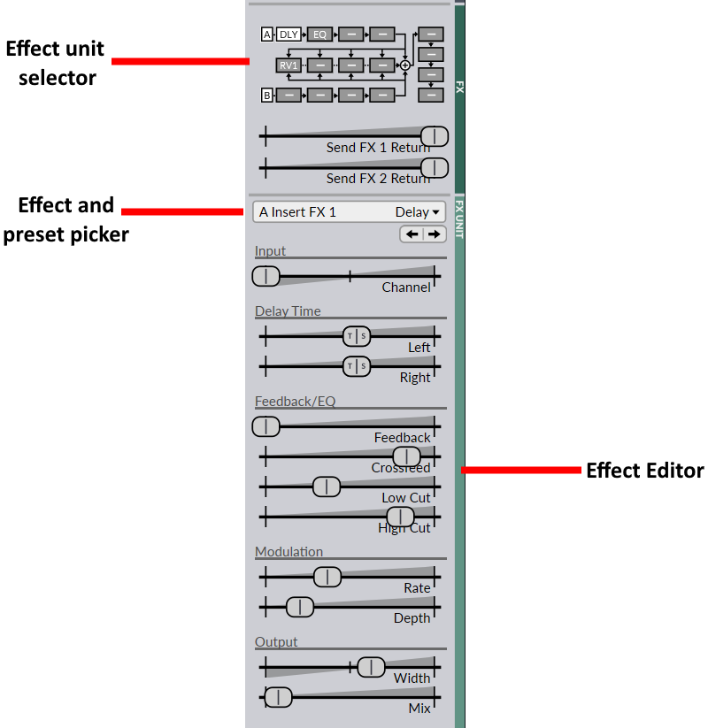
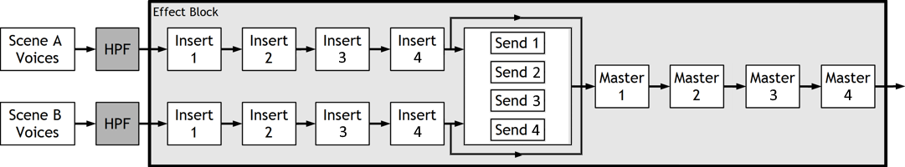

The FX Section controls the 16 effect units of the effect block
stored in every patch.

### Effect Unit Selector

The effect unit selector can be found towards the top of the FX section. It also represents the signal path
of the effects block. Here it is in more detail:

_The effect block_

A **left-click** on a particular unit in the effect unit selector brings that unit in the editor.
A **double-click** on a unit disables/enables it. This state is stored within patches,
unlike the global FX bypass setting.
A **right-click** on a unit displays the effect and preset picker specifically for that unit, allowing you to directly
add or swap an effect on that unit.
An **Alt/Option + Click** clears the desired FX unit.

Moreover, you can drag-and-drop units over other units to make them switch places. Holding down **Ctrl/Command** and
dragging allows you to duplicate (copy) units on other units instead, and holding **Shift** allows to simply replace
(overwrite) the target unit with the source one.

Finally, you can right-click on either the **A** or **B** icons in the diagram to bring up output hard clipping
options, which are the same as explained earlier in the [Scene Output](/surge-xt/manual-nightly/scene-controls/#scene-output)
and [Global Volume](/surge-xt/manual-nightly/header/#fx-bypass-character-global-volume) sections.

### Effect and Preset Picker

Effects can be added or removed from the **Effect and preset picker**
(just below the FX return sliders). You can also cycle through effects and presets using the
same arrow buttons as those found in the global [Patch Browser](/surge-xt/manual-nightly/header/#patch-browser), or by hovering
over either menu and using the mousewheel.

The effect menu groups the available effects into several nominal types: **FILTERING**, **DISTORTION**,
**MANGLING**, **MODULATION**, **TIME & SPACE** and **MISCELLANEOUS**.

The preset menu lists the presets for the currently selected effect only. Alongside them, a **FUNCTIONS**
column holds the following entries:

-   **Deactivate** (or **Activate**) the current FX slot, also available by double-clicking the slot.

-   **Clear** the current FX slot.

-   **Clear Current FX Chain** and **Clear All FX Chains**, which empties all four slots of the chain
    currently selected slot belongs to, or every slot in the patch.

-   **Save FX Preset As...** stores the current effect and its parameter values as your own preset.

-   **Delete FX Preset** removes the preset currently loaded in the slot, and only appears for user presets.

-   **Save FX Chain Preset As...** stores the whole chain rather than a single effect - see
    [FX Chain Presets](#fx-chain-presets) below.

-   **Copy FX Preset** and **Paste FX Preset** copy an effect and its parameters to another slot.
    You can also use drag-and-drop gestures to accomplish this (see [Effect Unit Selector](#effect-unit-selector)).

-   **Copy FX Chain** and **Paste FX Chain** do the same for all four slots of a chain at once.

-   The **FX Chains** submenu lists the factory and user chain presets in separate sections.

-   **Refresh FX Preset List** rescans the preset folders, which is useful if you have added
    preset files from outside Surge XT while it was running.

When invoked by right-clicking a unit in the [Effect Unit Selector](#effect-unit-selector) rather than
from the picker, the slot and chain entries name the actual slot and chain - **Clear Scene A, Insert FX Slot 1**
and **Clear Scene A Insert FX Chain**, for instance - instead of saying "Current".

Saving a preset over one that already exists asks for confirmation first.

#### FX Chain Presets

An ordinary FX preset stores one effect. A **chain preset** stores all four slots of a single chain together.

Chain presets are not tied to the chain they were saved from. A chain saved from the global FX chain can
be loaded into Scene A's insert chain, making them a convenient way to keep a favorite combination of
effects around and drop it wherever you need it.

### Effect Editor

This is where every effect parameter can be edited. Like with the oscillator editor, the parameter of each slider
will change depending on the loaded effect.

Here's a list of the available effects:

**Filtering**

-   [EQ](/surge-xt/manual-nightly/technical-reference/#eq)
-   [Exciter](/surge-xt/manual-nightly/technical-reference/#exciter)
-   [Graphic EQ](/surge-xt/manual-nightly/technical-reference/#graphic-eq)
-   [Resonator](/surge-xt/manual-nightly/technical-reference/#resonator)

**Distortion**

-   [Bonsai](/surge-xt/manual-nightly/technical-reference/#bonsai)
-   [CHOW](/surge-xt/manual-nightly/technical-reference/#chow)
-   [Distortion](/surge-xt/manual-nightly/technical-reference/#distortion)
-   [Neuron](/surge-xt/manual-nightly/technical-reference/#neuron)
-   [Tape](/surge-xt/manual-nightly/technical-reference/#tape)
-   [Waveshaper](/surge-xt/manual-nightly/technical-reference/#waveshaper)

**Mangling**

-   [Combulator](/surge-xt/manual-nightly/technical-reference/#combulator)
-   [Frequency Shifter](/surge-xt/manual-nightly/technical-reference/#frequency-shifter)
-   [Nimbus](/surge-xt/manual-nightly/technical-reference/#nimbus)
-   [Ring Modulator](/surge-xt/manual-nightly/technical-reference/#ring-modulator)
-   [Treemonster](/surge-xt/manual-nightly/technical-reference/#treemonster)
-   [Vocoder](/surge-xt/manual-nightly/technical-reference/#vocoder)

**Modulation**

-   [Chorus](/surge-xt/manual-nightly/technical-reference/#chorus)
-   [Ensemble](/surge-xt/manual-nightly/technical-reference/#ensemble)
-   [Flanger](/surge-xt/manual-nightly/technical-reference/#flanger)
-   [Phaser](/surge-xt/manual-nightly/technical-reference/#phaser)
-   [Rotary Speaker](/surge-xt/manual-nightly/technical-reference/#rotary-speaker)

**Time & Space**

-   [Convolution](/surge-xt/manual-nightly/technical-reference/#convolution)
-   [Delay](/surge-xt/manual-nightly/technical-reference/#delay)
-   [Floaty Delay](/surge-xt/manual-nightly/technical-reference/#floaty-delay)
-   [Reverb 1](/surge-xt/manual-nightly/technical-reference/#reverb-1)
-   [Reverb 2](/surge-xt/manual-nightly/technical-reference/#reverb-2)
-   [Spring Reverb](/surge-xt/manual-nightly/technical-reference/#spring-reverb)

**Miscellaneous**

-   [Airwindows](/surge-xt/manual-nightly/technical-reference/#airwindows)
-   [Audio Input](/surge-xt/manual-nightly/technical-reference/#audio-input)
-   [Conditioner](/surge-xt/manual-nightly/technical-reference/#conditioner)
-   [Mid-Side Tool](/surge-xt/manual-nightly/technical-reference/#mid-side-tool)

See [Effects](/surge-xt/manual-nightly/technical-reference/#effects) in the Technical Reference section for more information about each effect.

Note: remember that **FX parameters are scene controls**. This means that only scene-level modulation sources
can modulate them.
