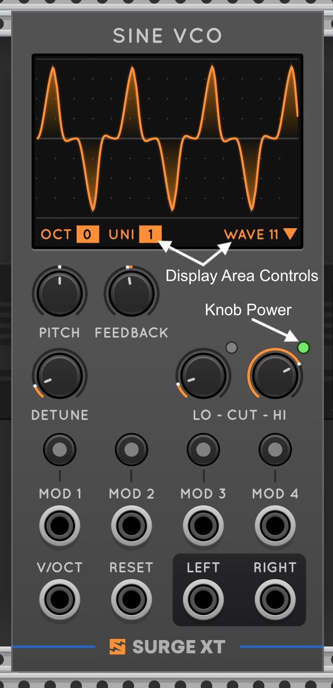
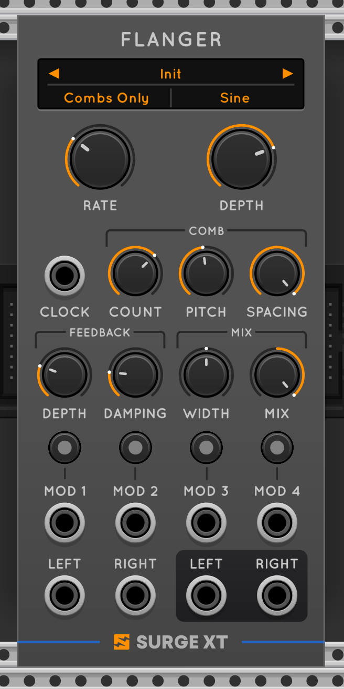
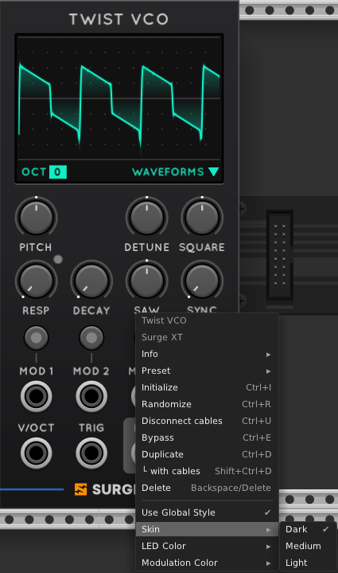
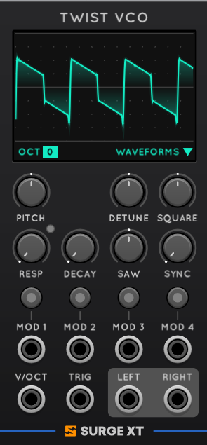
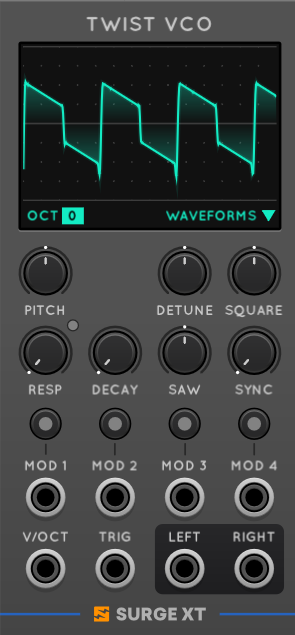
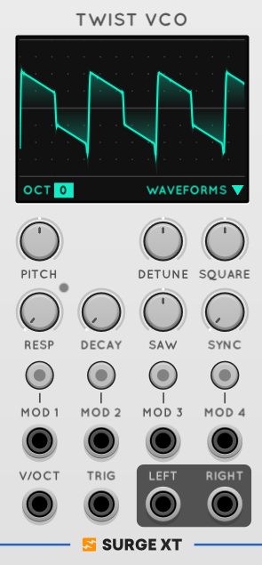

The module set strives for a high degree of consistency in the panels, and there are several
core concepts which cover nearly every module which you should understand before you turn
to the particular modules.

### Knobs, Switches, and Display Area Controls

All Surge XT modules share a few basic features, shown in the above annotated image of the
Sine VCO and the Flanger. All components in Surge XT support the full set of Rack 2 features, including
value tooltips and typeins, using the standard Rack gestures. We can see almost all the
core UI features on the screenshot above of the Sine and Flanger modules.

- Knobs with rings to show their value, which can either be uni- or bi-polar. Knobs
  are labeled, and some panels have dynamic labels below knobs.
- Toggleable knobs have power buttons (here the green lit button above HI CUT in the Sine). For these
  you need to toggle the knob "On" for the feature to be in effect.
- Controls in the display area (here unison, octave, and wave shape in the Sine) will open a menu , In FX, controls in the preset area (like
  on click and support a knob-style drag gesture. Labels in FX display areas (here
  "combs only" and "sine" in the Flanger image) will open a multi-choice menu.
- Presets and Model Choices (here the item at the top of the flanger) present a left-right jog buttons
  and open a menu when selected.

The modules with display area charts will update those charts in realtime based on values
and modulations. We endeavour to make sure the charts show what is actually happening
in an appropriate fashion!

### Modulation

Surge XT contains an advanced modulation system where every module contains a many-to-many
modulation matrix from 4 CV inputs to each of the knobs.

To modulate a value:

- Attach a CV input into one of the four mod inputs.
- "Arm" the corresponding modulator by pressing the button above the input. (Or with the module focused, use Alt/Opt + 1-4 to toggle modulators armed)
- Once armed, each modulatable knob or slider will switch from
  a value display to a modulation depth display.
- Drag the knob to adjust the inbound modulations effect on the parameter.
- While modulating, you can use shift-alt drag to edit the parameter's baseline value.

The modulation bounds and tooltip on the knob while editing modulation
show a bipolar level which is the impact of a + or -10V signal. If you are using
a +/-5V modulator (as opposed to a 0-10v modulator) you may need to set your depth higher.

Finally, this modulation gesture is far more natural to just do or see than it is to write
about! We strongly suggest you watch Omri's video or just try the modules if this doesn't make
sense.

### Polyphony

All the Surge XT modules are Polyphonic. Polyphony is driven by natural inputs
(V/Oct, Trigger, and so on) in each module. Each of the FX (except the Delay, as
discussed below) can work either monophonically, summing inputs, or optionally
polyphonically, with an instance of the FX per channel.

Modulation inputs do _not_ set polyphony in modules. Instead, a module which has
polyphony P will interact with modulation with polyphony M as follows:

1. P=1, M=1: This is the simple case. It's just all monophonic!
2. P=n, M=n; if the modulator and module polyphony match, each modulator addresses each voice
3. P=n, M=1; if the module is polyphonic and the modulator monophonic, the
   modulator is broadcast to each polyphonic voice
4. P=n; M=m, m!=n; In this case the first m modulator channels are used for
   the first m voices, and any voice n > m gets modulation value 0.

### TempoSync and Clocks

Surge XT supports temposynced values across the time-based effects, and we have
extended those features to the Surge XT modules. If a module supports tempo-sync
values, it has a CLOCK input.

The CLOCK input can take two forms, which you can toggle between in the module
menu.

- CLOCK - the module expects a quarter-note trigger. Establishing tempo will require
  multiple triggers and tempo changes will lag.
- BPM CV - the module expects a CV signal for the tempo frequency, as output by
  popular modules such as CLOCKED. This allows instant setting and changing of tempo.

The panel label for the CLOCK input will change based on the mode you select.

### Skins, Colors, and Animations

We love the way the Surge modules look, but we also know people like picking colors,
light and dark modes, and the like. So we added all of that!

On any module you can right click and choose between three skins (light, medium, and dark)
and can choose the colors for the panel displays, the knob rings and the modulation gestures.
You can also deactivate animation and drawing features on the display.

Bu default, changing a skin or a color changes your global state and all Surge XT modules
will follow. If you want, you can also decouple a module from the global state and it
will have independent retained colors and skin settings.

Here are some examples of the base skins:

### Extra Controls in the Menus

The Surge VST is a menu-driven experience for many controls, and some of the lesser
used options in the VST are not on the front panel but are in the module menus per module.
We strongly suggest you look at the module menu since it contains a bunch of great
features!

### Block Size and Latency

By virtue of being a VST, Surge is designed for a block-processing environment as
opposed to a per-sample processing environment. This means there are a collection
of places where latency can appear or modulators are snapped less frequently than
per sample.

Luckily, in the Surge XT modules, we have undertaken the work to make the Surge code
base use a compile time variable block size, and for the Rack implementation, set the
module block size to 8 samples, greatly improved from the 32 sample condition
in the prior rack implementation.

Most of the time, everything will simply work as you think, and you don't need to worry about block size.
There are a few exceptions and considerations, which we'll come back to where relevant.
