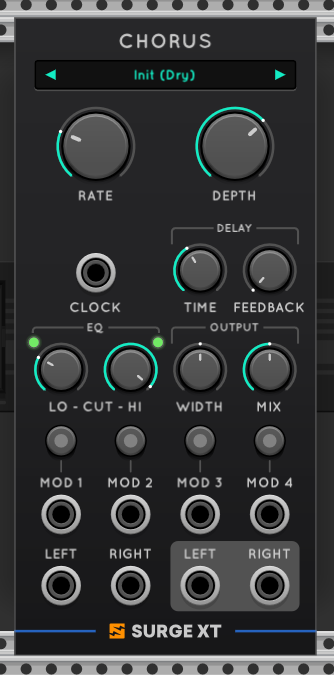
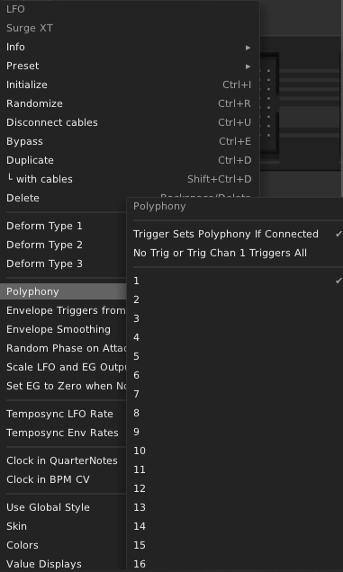

### The Effect List

Each of these effects is described in more detail in the [Surge XT manual](/surge-xt/manual/effects/).

- Reverb/Delay
    - **Reverb1**: A digital reverb, good for short gated type sounds, a bit odd in long tails
    - **Reverb2**: A more lush reverb, good for spatial or ambient sounds
    - **Spring Reverb**: A detailed model of a spring reverb, including knock and chaos effects.
      Can be CPU intensive.
    - **Delay**: A Digital Delay, strictly monophonic but supports delays up to 10 seconds and includes
      tempo-sync without a block latency delay.
    - **Nimbus**: The Surge port of a famous euro-rack granular reverb/delay/spectral manipulator.
- Modulation Effects
    - **Phaser**: A digital phaser with many options to control the filter network
    - **Flanger**: A flanger with some advanced feedback and tuning options
    - **Rotary Speaker**: A rotary speaker model, including two horns and an overdrive phase
    - **Chorus**: A clean digital chorus
    - **Ensemble**: An ensemble/chorus model based on a detailed model of a BBD chain,
      akin to ensemble effects in older string synthesizers. Can be CPU intensive.
- Distortion and Saturation
    - **Distortion**: The name kinda gives it away right?
    - **Neuron**: A saturation circuit
    - **Chow**: An interesting asymmetric saturator
    - **Bonsai**: A broad ranging tape saturation and distortion model.
- Special Effects
    - **Frequency Shifter**: A stereo extendible frequency shifter
    - **Ring Modulator**: A model of an analog ring modulator, with a multi-shape unison internal carrier
    - **Vocoder**: A vocoder with selectable bands and filter parameters
    - **Resonator**: A filter bank configured like classic resonator modules
    - **Combulator**: A bank of comb filters with feedback
    - **Exciter**: An exciter to add "sparkle" to your sound
    - **TreeMonster**: A pitch detection circuit which generates a tuned tracker signal you can
      ring modulate against. Its kinda crazy!

### Polyphony

All the Surge FX except the Delay can run in either a monophonic or polyphonic mode. In monophonic mode,
the FX sum the inputs and hand them to a single instance of the effect. In polyphonic mode, there is an instance
of the effect for each polyphonic channel, adding substantial CPU in some cases, but
also adding polyphonic separation. All FX default to monophonic mode, except for TreeMonster which defaults to polyphonic.

You can toggle polyphony behavior in the module menu.

#### FX Block Size Considerations

Except for the Delay, all the above effects work with a block size of 8, so have to collect 8 samples before
processing. As such they add an 8 block latency to input signals, and audio rate mod will cause the aforementioned aliasing issues.
