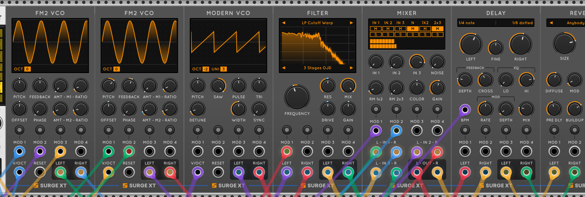

Surge XT modules for VCV Rack is a collection of modules which brings the majority of the DSP code
from Surge XT into the VCV Rack environment in a modern and carefully designed fashion.

This manual is a collaborative work in progress. We are happy to merge pull requests and changes!

### Omri Cohen's Overview Video

A great starting point if you are impatient is to just
watch our beta-day launch video from Omri Cohen. Thanks for making such a great
video, Omri, and awesome flute playing!

<iframe
    class="aspect-video w-full"
    src="https://www.youtube-nocookie.com/embed/8MavXLbI50A?si=QrP9uBBgCLRZUsLe"
    title="YouTube video player"
    frameborder="0"
    allow="accelerometer; autoplay; clipboard-write; encrypted-media; gyroscope; picture-in-picture; web-share"
    allowfullscreen></iframe>

### Collection Overview

Surge XT contains a collection of modules which project the core capabilities of the
Surge XT synth into VCV Rack. It contains multiple VCOs, multiple FX, a Filter module
with a large number of complicated filter modes, a Waveshaper with multiple shaper models,
an LFO/Envelope Generator module, and a collection of utility modules.

This manual covers how to use these modules in VCV Rack, but it is intended to be read in
conjunction with the [Surge XT Manual](/surge-xt/manual/). Concepts like the meaning of a
particular setting in a VCO or a particular knob on an effect are covered there in detail,
and we won't repeat that information here.
