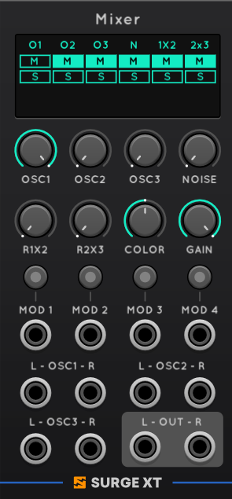
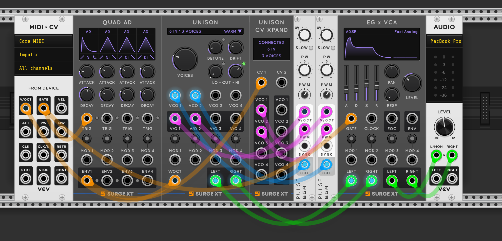
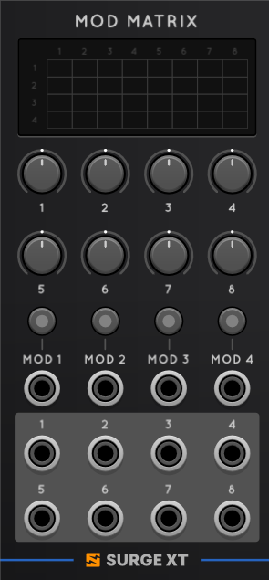

We have two mixer modules. One is intended for audio signals, the other for modulation, though you can do it "wrong" if you like.

### Mixer and Mixer with Sliders

The Rack Mixer is an implementation of the VST mixer section. It contains

- Three stereo oscillator inputs with independent modulatable gains
- 2 digital ring modulators (1x2 and 2x3)
- A noise source with filtering (color)
- Full polyphony and modulation support
- Mute and Solo for each channel

There is a version with knobs, and a version with sliders. They do the same thing, just different face plates.

### The Unison Module and Unison CV Expander

The unison module allows non-Surge VCOs to participate in surge unison. It does this by providing
a function which converts a polyphonic v/oct signal into an expanded polyphonic v/oct signal, and then
by collecting and mixing resulting higher-polyphony audio signals into a stereo field. It has an expander
allowing you to route CV along the same polyphony-expansion path, sports a low and high pass filter, and provides
drift and character effects from the Surge VCOs.

Patching the module requires some care. The simplest case is taking a monophonic v/oct in, which then generates a
N-voice polyphonic v/oct out. Patch that to your favorite poly VCO, take the audio output from that VCO back into
the unison module audio in, and you will get a stereo unison.

As voice count increases you may need extra VCOs. The module supports up to 4 subordinate VCOs, allowing up to 64
unison voices, so can add 4-voice unison to 16-way polyphony or up to 9-voice unison with 7 voice polyphony if all the
VCOs are connected.

To see a demonstration of the unison module just before we shipped 2.2, we prepared this [development preview](https://youtu.be/w0fXLlHKLrk).
A complete wiring, used to make two BogAudio PWM VCOs participate in polyphonic unison with a PWM sweep, is shown here.

### The Mod Matrix

We think the Surge modulation matrix model is really great! And it would be great
if we could extend it to other modules. In order to do that, we include a mod matrix
module which is simply a collection of knobs which output fixed voltage to the associated modulation output.
Since these knobs are modulation targets, you can use them to generate 8 re-mixed modulations
from 4 modulation sources to route to other CV sources.

Patch output 1 to the destination you want to modulate. Then bring the modulation sources you want to use into the mod inputs.
Then arm the modulators and assign them to knob 1 one by one. The opt/alt + 1,2,3,4 shortcuts come in handy here for
adjusting the amount of each modulator that goes into the mix.

#### Mixer Block Size Considerations

These are per-sample throughout, no latency or aliasing from audio-rate signals.

