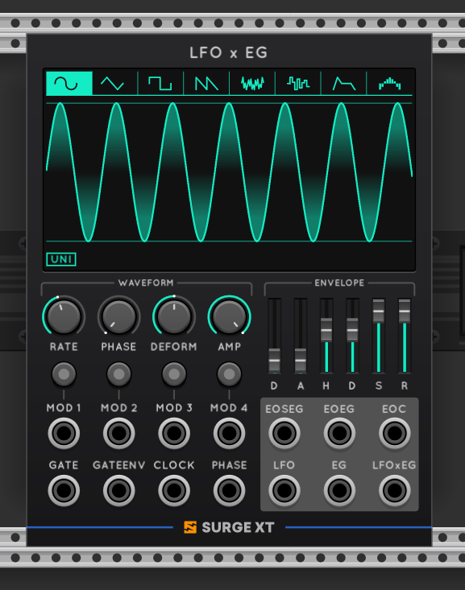
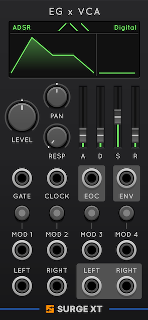
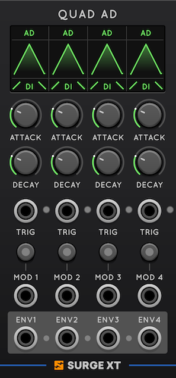
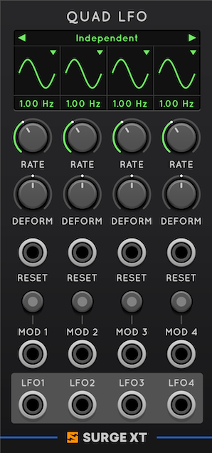

### LFOxEG

The LFOxEG module is built around the main modulator type in the Surge VST. It is an LFO with various shapes including two
random modes and a step sequencer. The amplitude of its output is scaled by a DAHDSR envelope generator.

- **LFO** Continuously outputs the LFO wave.
- **EG** Outputs the envelope shape.
- **LFOxEG** Is the main event, it outputs the LFO wave scaled by the envelope.

The [Surge XT manual](../manual-xt/#lfos) has some more info on each LFO shape, though the display of the module itself will
most likely tell you what you want to know.
The straight lines above and below the LFO wave display are showing you the how the envelope influences the LFO wave output.
The envelope also influences the output of the Step Sequencer type, though this is not shown on the display.

The controls are mostly self-explanatory, and their effects are also shown on the display area. The Deform control
has different effects depending on the selected LFO type, and some of the types have different Deform options, accessible
via the module menu. Deform only affects LFO and LFOxEG outputs, never the EG output (even in the envelope type).

There is a switch in the bottom left of the display area for the output polarity.
In the default mode, LFO output range is +/- 5V. In Unipolar mode, its range is 0V-10V.
The step sequencer type and the EG output are an exception. They never go to negative voltages.
Their range is 0v-5V by default, and 0v-10V in unipolar mode.

There's also some end of cycle-type outputs, which send a trig at the end of various internal events.

- **EOSEG** triggers at the end of each stage in the envelope generator.
- **EOEG** triggers at the end of the entire envelope, after the release stage.
- **EOC** triggers at the end of each complete cycle.
- **A/B** (Step seq mode only), trigger at the selected steps in the sequence.

The **Gate** and **GateEnv** both open up the EG. The difference is that the Gate also resets the LFO phase, while the GateEnv does not.
We do not currently recommend patching both of these at the same time.

**Clock** will take a clock input to tempo-sync the module. By default, the LFO will sync to clock when connected, but the EG will not.
You can change that, and also choose clock signal types in the menu.

The **Phase** input will stop the LFO from cycling, and let you control the position in the LFO wave directly with a 0-10v input.

There are a number of menu options.

- _Polyphony_ works the same as everywhere else
- _Envelope Triggers From Zero_ makes the envelope restart from zero when triggered. Defaults to off, meaning envelopes will restart from the current value.
- _Random Phase on Attack_ is fairly self-explanatory.
- _Scale LFO and EG outputs by Amp_ defaults to on, meaning the Amp knob affects LFO, EG and LFOxEG outputs. Turn off to make Amp affect LFOxEG output only.
- _Set EG to Zero when No Trigger Connected_ sets whether the EG output defaults to open or closed when nothing is patched to the gate inputs.
- _Rack Randomization Changes Shape_ defaults to on. Turn this off to randomize parameters while staying on the same LFO type.

### EGxVCA

When making voices in VCV Rack, you typically use an envelope generator plus a VCA to control amplitude.
This module combines both in one, with stereo inputs/outputs and a pan control!

The envelope can either be a typical ADSR (suitable for sustained synth voices) or a less common DAHD (suitable
for drums). Toggle between these in the top left of the display.

The envelope segments can be adjusted for many different kinds of response. The envelope sliders are labelled and self-explanatory.
At the top of the display area, you can change the curve of each segment between faster, slower, and standard curves.
Like the Surge VST amp and filter envelopes, this EG can also be toggled between digital and analog modes, which have
different curve behaviors. There's also the Response parameter, which subtly changes the curve shapes to tame
or exaggerate pops and clicks.

The pan control will work for both mono and stereo inputs. And since the module is polyphonic, voices
can be panned independantly with modulation.

Like the LFOxEG module, this one has clock signal options (for tempo-sync of envelope segments) and retrigger options in the menu.
We also have two Pan behaviors for stereo inputs.

- With the default behavior, panning left gradually silences the right side signal.
- With the optional "true panning" behavior, panning left gradually moves the right input to the left output.

### Quad AD

Four envelope generators in one module, perfect for percussive sounds!

The EG can be either attack-decay or attack-(sustain)-release. In either case you get the same three curve options and
analog/digital modes you had in the EGxVCA. Also, like our other EGs it has retrigger from zero/current options in the menu.

Each EG gets an independant trig/gate input, and attack/release time controls.

Make sure to try out the buttons in between the trig inputs. They allow you to link the end of cycle from each EG
to the attack of one of its neighbors, so you can chain the EGs into a longer cycle.

### Quad LFO

The Quad LFO combines four identical simple LFOs, which interact with one another in one of five ways.
Each LFO has the same types as the LFOxEG module available (minus the envelope and sequencer types), which
can be either unipolar or bipolar. There's also a new mode called Random Trigger, which has a chance to choose
a new random value every trigger/cycle. The deform parameter controls the chance that the output value changes.

Besides the 4 modulation inputs and outputs, it has 4 variable inputs that change behavior depending on the inter-operation mode.

The modes are:

- **Independent**: Each LFO is oblivious of the others, with its own rate and deform controls and reset input.
- **Rate Ratio**: The first LFO sets the tempo, and the others are synced at integer multiples/divisions of the first.
- **Quadrature** Puts the LFOs at fixed 90 degree phase offsets. The first controls rate, you can change amplitudes of the others.
- **Phase Offset** Like Quadrature, except the amplitudes are fixed, and you can alter the phase offsets instead.
- **Entangled** You can set a baseline value for each parameter, and then spread the LFO's out from that baseline.

All the inter-operation modes except Independent have a Reset trig input to start the cycle over from the beginning, and a
clock input for tempo sync. There's also a freeze input, which stops all LFOs in their tracks when it receives a high gate.
Last but not least, you can reverse the pattern with a trig to the Reverse input.

The module is polyphonic, by default the poly count on the Reset input.

#### Modulator and Envelope Block Size considerations

These modules process modulation input per-block.
The envelopes respond to triggers in a sample accurate manner though, so no latency there.
