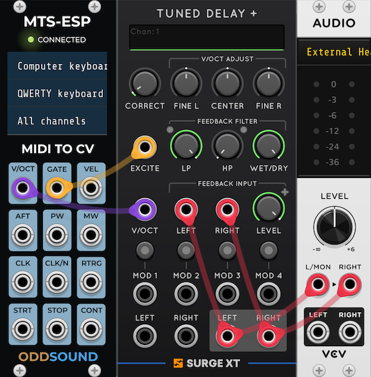

Surge XT for Rack now has two special delay modules which are parameterized for physical modeling applications.
They are delays in a DSP sense, but functionally you might as well call them experimental VCOs (though they can also serve as FX).

At the heart of both Tuned Delay modules is a very short delay, which has its length controlled by a V/Oct input such that
the delay time is always one cycle at the intended frequency. I.e. if the V/Oct input indicates a frequency of 1000 Hz the delay time will be
one millisecond, if it indicates 100 Hz the time will be ten milliseconds etc.

If you add feedback to such a tuned delay, and send it a short burst of sound, it creates a sound somewhat like a plucked string,
with the amount of feedback controlling how long the sound takes to decay. This is Karplus-Strong synthesis.
But you could also patch a vco to the input and use them

### Tuned Delay

This is the bare-bones version of the idea.
It has stereo inputs and outputs, and a V/Oct input.
The V/Oct Center parameter acts like the pitch control on a VCO. Type in whole number like 1, 2, -1 etc to change octave, for example.

To use this module, send some sound into the input, mixed with the sound of the output to create a feedback loop (you'll need a mixer).
Adding other modules into that feedback loop can create many kinds of interesting results.

That's what the Sample Correct control is for. Long story short: Count the number of cables the signal passes through
between the output and the feedback input, and make sure this parameter is set to that number.

Why? Every cable in VCV Rack introduces 1 sample of latency, which means if you patch some modules into the feedback loop,
the cables will _very slightly_ lengthen the delay time. This would make the module play out-of-tune in
high registers, so we put the Sample Offset control in to let you compensate.

### Tuned Delay+

The Tuned Delay+ module is the same DSP, with some useful patching tools built-in.
You could say the seemingly simpler one is the advanced tool, whereas this one is the more user-friendly version
that helps you out a little more.

There are stereo inputs and outputs, and our familiar four modulation inputs.

The V/Oct input, and the Center parameter, are explained above. The Fine L/R parameters do the same thing as Center,
but have a much smaller range and work independantly for the left and right channel.

The feedback inputs save you from having to use a second module to mix output back into the input.
We recommend starting out simply patching L/R outputs to the L/R feedback inputs.
The Level control attenuates the feedback signal, effectively controlling both the decay time and timbre of the sound.
By default the control goes from -1dB to 0dB, where the most sensitive range is. If you want to be able to bring the
feedback down to silence though, you can press the plus sign over the dial.

There are optional high- and low-pass filters in the feedback path to shape the sound further. These filters track
V/Oct, the dials control the offset from the root frequency. The wet/dry control blends filtered and unfiltered feedback.

The exciter input directly applies a 0-10v CV to the amplitude of an internal noise generator, sent into the
delays feedback path. If you've got output patched into the feedback as described above,
you can send trigs to the exciter port to play the module. The length of the trig will greatly impact the sounds you get.

This is the essential way to patch Tuned Delay+ as a Karplus-Strong VCO. V/Oct, trig to Exciter, and Output to Feedback.
Just like with the simple Tuned Delay, the Correct parameter should be set to 1 in that scenario. For each module you
add to the feedback path, turn Correct up by 1.

#### Tuned Delays Block Size considerations

Our delay line processes per-sample. So these will not introduce any (additional) latency to signals.
This also makes parameters that directly control the delay time good targets for audio-rate modulations.
Just like with the Waveshaper, the filters in the Tuned Delay+ feedback path calculate per block and will alias at high audio rates.
