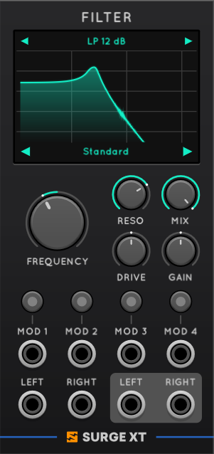
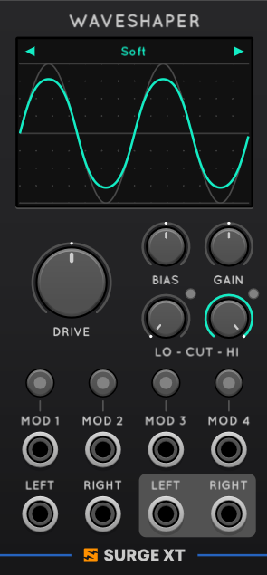
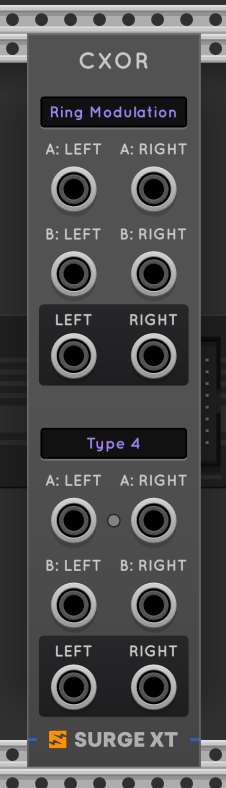

### VCF

The Surge XT VCF presents all of the Surge XT filter types and subtypes in a single module.
There are preset menus at the top and bottomr of the display to select the core model and sub-type. The subtypes drastically alter
the core models behaviors, we strongly encourage you to explore all the combinations.

The module runs in polyphonic stereo with mix, pre- and post- gain, cutoff and resonance controls
which all do exactly what you'd expect.

What it doesn't have is a dedicated V/Oct input. But you can make it pitch tracking by patching a V/Oct signal into
a mod input, and assigning it to the frequency dial at full depth. Note that not all the filters play in tune consistently
throughout their range, for some of them the tuning will vary with feedback and input level. Some of them play in tune
very reliably though. the 24dB Lowpass and the OB-Xd Bandpass and Notch filters are particularly consistent.

The VCF display shows the result of transforming a chirp sweep through the filter as configured. It is the
actual filter response calculated in near-realtime.

#### VCF Block Size Considerations

The surge filters are sample accurate adding no latency, but calculate coefficients every 8 samples and then
smooth over the block. This means the filters handle feedback well, but filter FM has the same limitation as audio rate modulation on the VCOs.
Can sound great for deep basses, but will easily fall apart in high registers.

### Waveshaper

The Surge XT Waveshaper presents all the waveshaper models from Surge in a single module. It
Using the preset menu at the top of the display, you can choose the waveshaper model to apply.

The module gives you control over bias, which adds DC offset before the waveshape and subtracts it after, making the waveshaping assymetric.
There's also a drive control (pre-gain), optional high- and low-pass filters, and a post gain control.

The Waveshaper display shows the output of the waveshaper, as presently configured, with input of a +/- 5V amplitude sine wave.
This is the quickest way to get an overview of the various shape options the module provides.

#### Waveshaper Block Size Considerations

Unlike the filter and VCOs, the waveshaper module processes both audio and modulation per-sample. This means it's much better suited for
audio rate modulation than the previously discussed modules. The Drive and Bias controls are particularly suitable targets, with
very different results depending on which waveshape is selected. The coefficients on the filters are still per-block however,
so the filters dials are somewhat less suitable targets, comparable to the VCF.

### Digital Combinator / CXOR

The Digital Combinator module provides two independent polyphonic circuits which can use a variety of digital
signal combination techniques to add texture and growl to a pair of signals. The basic setting 'Ring Modulator',
upsamples the signal, multiplies a \* b digitally, downsamples, and sends it to the output. As a result this
module has a latency of 4 samples, the minimum block size for the Surge halfband up/down filters.

The module also features a large number of other combination functions, though, each with a unique and signal
dependent character. The best approach is to just try them and see what sounds good!

Finally, the module allows a double-cascade. If the second input "A" input has the power button between
the inputs activated, the second circuit will use the output of the first as its input without the cost
of an additional up/down sample, allowing for a wide variety of three-signal combinations.

