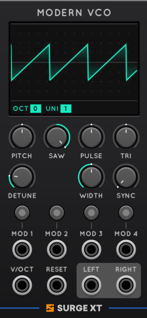
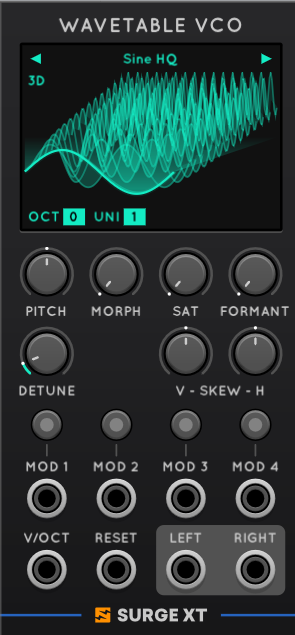
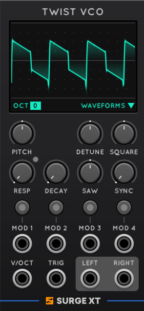
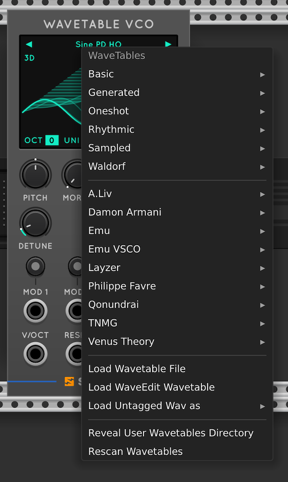

### Oscillator List

The Surge XT collection contains the following VCOs from the Surge oscillator section:

- **Classic** - a classic analog-style saw and square oscillator
- **Modern** - an analog-style multi-shape oscillator
- **Sine** - a sine wave oscillator with a collection of shaping functions, unison, and filtering options
- **FM2** - a 3 operator (2 modulators and a carrier) FM operator with integral C:M ratios
- **FM3** - a 4 operator (3 modulators and a carrier) FM operator with arbitrary and absolut-able C:M ratios
- **Wavetable** - a modern wavetable oscillator with multi-wavetable loading and warping
- **Window** - another wavetable oscillator using fixed windowing functions
- **S&H Noise** - a tuned noise generator
- **Alias** - a purposefully gritty and aliasing oscilator
- **String** - an oscillator with a pair of physical string (Karplus-Strong-style) models, multiple exciters, and more
- **Twist** - The SurgeXT adaptation of Mutable Plaits

Each oscillator is documented more thoroughly in the [Surge XT manual](../manual-xt/#oscillator-algorithms).

### Common Features

The oscillators all have a collection of common features, available on the right mouse menu. Some
oscillators have VCO-specific menu items also. Among these options are

- Character: A set of basic filters to make the output warmer or brighter
- Oscillator Drift: A low frequency pitch drift applied across the life of the oscillator for an "analog" style
- Output Attenuation: A fixed attenuator to "turn down" an oscillator; especially useful at high unison and low detune
- Halfband Filter: Alternate half-band filters to downsample the internally oversampled oscillators. At high
  polyphony, you may save some CPU at some quality expense by chosing an lower-M version
- DC Blocker: All the VCOs have a very low frequency high pass filter as a DC Blocker. You can deactivate this if you want.

### Tips for limiting CPU

The Surge VCOs use a collection of techniques to guarantee low CPU while maintaining high audio quality. But there
are some things which can drive the CPU high in VCOs.

In general, the Modern, Twist, and WaveTable CPUs are among our most intensive, and Classic is among the lightest.
VCOs increase CPU count roughly linearly in unison count; a unison count of 3 or 5 is almost always as high as you want
to go. Larger (higher number of points) wavetables can be more expensive than smaller ones. And finally, of course,
higher polyphony means higher CPU usage.

### Wavetables

The two surge Wavetable based oscillators ship with the factory section of the Surge XT wavetable bank. These wavetables can be
accessed from the display area menu.
The 3rd party section has been omitted by default, (to make the library download smaller). You can however
easily access our 3rd party wavetables from the wavetable menu, just press "download extra wavetable content".

The VCOs will also read wavetables in a variety of formats,
including the popular wavetable formats used by Serum (2048-long tagged .wav) and
Bitwig (.wt). It also interprets WAV loop markers as wavetables.

Wavetables in other formats require pre-processing. Unprocessed audio files will be loaded as one shots.
For more on this consult the [Surge XT manual](../manual-xt/#wavetable).

Since wavedit (with its 256-block untagged wav file) is a popular format, we have added
a special menu in the Surge XT Rack modules, where you can load this file directly from
the wavetable menu using the "Load WaveEdit Wavetable" menu item.

If you have a wav file which you know is a 512 wide wavetable, you can also load it explicitly
with "load untagged wav as" submenu

Finally, on startup surge will scan your surge user directory for additional wavetables,
so you can copy or link to those. To reveal the directory where Surge looks, use the
"Reveal User Wavetable Directory" entry. This is the same directory the VST uses, so if
you have already set up a user wavetable collection, they will appear in your menu.

Surge saves the selected wavetable in the VCV Json Patch, so if you make a patch then
remove a table from your system, your patch will still play in the future.

### VCO Block Size Considerations

All the Surge VCOs generate samples in blocks of 8, snapping the CV output at the start of the
block and smoothing to that value as an end of block target. In almost all music applications
this is unnoticable, but there are two consequences

1. Trigger events are processed every 8 samples, resulting in an amortized 4 sample delay
   on triggers; and
2. Audio-rate modulation has some aliasing issues. Very high notes or bright sounds likely won't sound pleasant.

### The Reset/Trigger input on VCOs

Each VCO has a "Reset" or "Trigger" input depending on its behavior.

If this input is labeled "Reset" resets the oscillator with the same action that happens at note on in the vst.
It resets phases for unison, restarts the note drift, and a few other things. If you patch a VCO to a scope module, set unison to 2 and
choose "Retrigger with Phase = 0", you will clearly see the effect of Reset in the scope.

For a few oscillators there are modes other than reset. String, Twist and Window/WaveTable in one shot mode toggle
from "Reset" to "Trig" to indicate that the init action restarts playback.

In String it re-fills the burst buffer and resets the modelling delay lines.

In Twist it re-triggers the built in LPG.

In Window/WaveTable in one shot mode it starts the one shot again. This mode is only active if you have loaded
a wavetable which acts as a one shot. In this case, on trigger the playback will start from the morph value which
is in effect when the trigger arrives.
