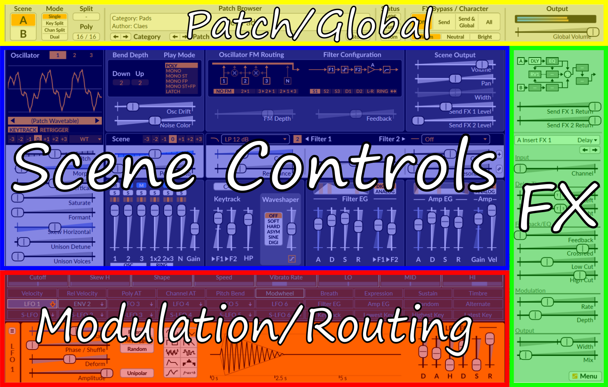
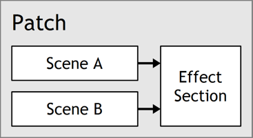
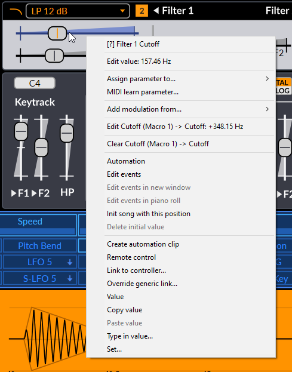
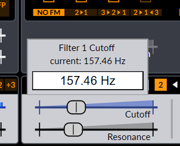
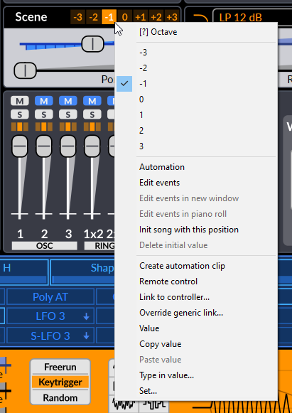
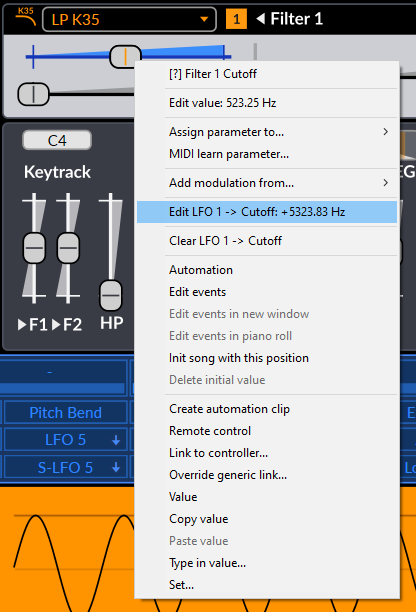
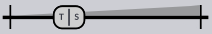

The user-interface of Surge is divided into four main sections:

-   Patch/Global
-   Scene controls
-   Modulation/Routing
-   FX

Keeping this structure in mind will make it easier to understand the layout.

_The four sections of the user-interface that Surge is divided into._

## The "Scene" Concept

Every patch in Surge contains two scenes (A & B) and an effect-section.
Both scenes and all effect settings are stored in every patch. A scene is similar to a
traditional synthesizer patch as it stores all the information used to synthesize a voice.
Since there are two scenes in each patch, it’s possible to have layered or split sounds stored within a single patch.
(see [Scene Select and Scene Mode](/surge-xt/manual/archive/1.9/patchglobal-section/#scene-select-and-scene-mode)).

## Audio Outputs

When loaded into a DAW, each instance of Surge has **3 audio outputs**:

-   Stereo Out
-   Scene A Out
-   Scene B Out

In some hosts, like FL Studio for instance, Surge will disable the individual scene outputs due to a conflict with
the DAW's audio routing architecture. To enable those additional outputs in such cases,
see [this option](/surge-xt/manual/archive/1.9/menu-button/#workflow) in the Surge menu.

## Sliders and controls

The most common user-interface control in Surge is the slider. They come
in both horizontal and vertical orientations but their functionality is
otherwise identical.

Sliders are always dragged, there is no jump if you click on the slider
tray instead of the slider head, it enters dragging mode nonetheless.

Slider interactions:

-   **Left-click drag** - Drag slider
-   **Shift + Left-click drag** - Drag slider (fine)
-   **Ctrl/Cmd + Left-click drag** - Drag slider (quantized steps)
-   **Alt + Left-click drag** - Drag slider in elastic mode (snaps back to initial position upon release)
-   **Scroll Wheel** - Move Slider
-   **Shift + Scroll Wheel** - Move Slider (fine)
-   **Double left-click** - Reset parameter to default value
-   **Right-click** - Context menu

Other than sliders, some of Surge's parameters are also displayed as number and value fields, buttons and button rows.

### Parameter context menu

Any parameter's context menu can be brought up with a right-click. This menu has numerous useful functions:

#### Name and contextualized help

Clicking on this first option will open this user manual to the correct section explaining the parameter in question.

#### Edit Value

This option allows you to type in the desired value of a parameter. Once the value popup appears, its text will already
be highlighted, and you can start typing the value right away. When you are done, simply press Enter to confirm
the change. To cancel and close this popup, simply press the Escape key or move any other parameter.

For discrete parameters (Unison Voices, or a button row for instance), instead of a type-in field, all the possible
values will be displayed right in the menu so it can be accessed directly.

If a control is modulated, there will also be edit options for the amount of modulation for each modulation source.
The entered value corresponds to the position of the modulation slider (blue slider) for that modulation source (see [Routing](/surge-xt/manual/archive/1.9/modulationrouting-section/#routing) for more information).

Note that in both cases, the actual unit of the parameter doesn't need to be typed in.

#### Extend Range

Some parameters can have their range extended. The option **Extend range** will appear in the context menu
if they do. **Pitch**, for instance, is one of those parameters.

#### Tempo Sync

Some parameters can be synchronized to the host tempo. The option **Tempo sync** will appear in the
context menu if they do.

Once tempo-synced, when using the Surge Classic skin, the slider will show a "TS" symbol on their handles to indicate that state, like so:

This indication can vary depending on the skin used.

#### Activate / Deactivate

Some parameters can be activated or deactivated. If a slider appears transparent or is missing its handle,
in some cases, it can be because the parameter is deactivated. To toggle it, simply use this option.

#### Assign parameter to...

This option allows to assign the right-clicked parameter to any MIDI CC.

#### MIDI Learn Parameter...

This is where you assign a MIDI controller to the desired slider. To abort MIDI learning on that parameter,
simply right-click again and the option will now become **Abort Parameter MIDI Learn**.

#### Clear learned MIDI (...)

This option will be available if the selected parameter has already been MIDI learned. It allows you to clear that link (the
existing link MIDI CC number will be shown in parentheses).

#### Add modulation from...

This menu entry allows to directly modulate the right-clicked parameter from any modulation source in Surge.
Once a source is selected, a pop-up window will appear and allow you to enter the desired modulation amount from
that source.

#### Clear Modulation

This menu also includes an easily accessible option to clear any or all modulation routings to a slider that is being modulated (those that have a blue tint) (see [Routing](/surge-xt/manual/archive/1.9/modulationrouting-section/#routing)).

#### VST3 Options

Finally, the VST3 version of Surge supports VST3 context menu items. Depending on the host,
there may be more or less options regarding automation, MIDI, or parameter values.
