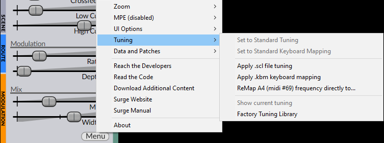
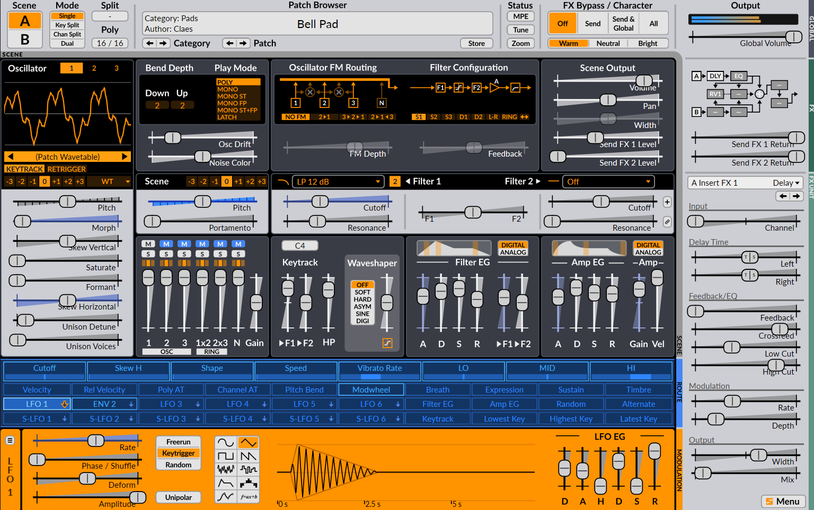
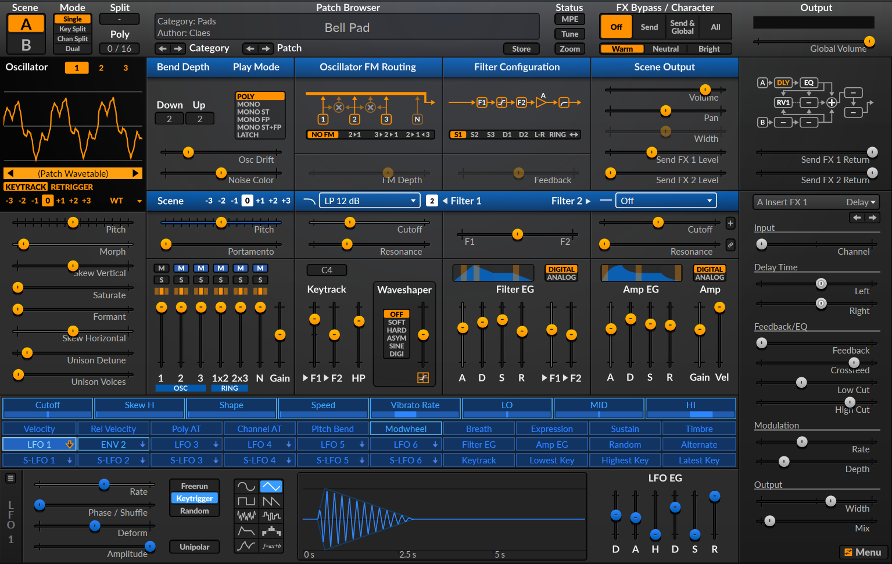
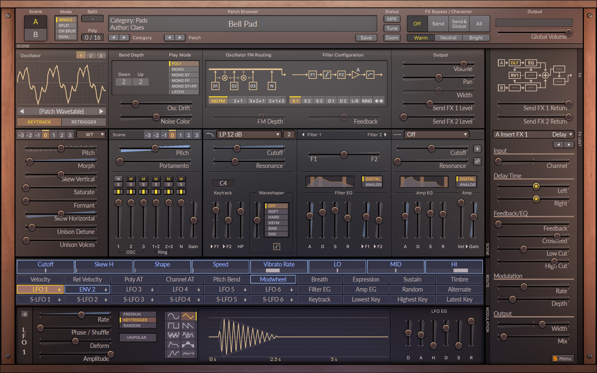

You can find this menu in the bottom-right corner of Surge's interface.
Clicking it reveals various configuration options.

Note: Some of these options are also present at the top of the user interface for easier access
(see [Status Area](/surge-xt/manual/archive/1.9/patchglobal-section/#status-area)).

This menu can also be opened by right-clicking anywhere on the user interface where there are no controls.

### MPE Options

**MPE** stands for **MIDI Polyphonic Expression**. It can be enabled or disabled in its sub-menu.
The current and default pitch bend range can be changed here as well. Finally, you can also configure
the MPE pitch bend smoothing amount.

### Tuning Options

Surge features full-keyboard microtuning support, and uses an implementation of the complete
**Scala SCL** and **KBM** microtuning format.

The **Tuning** menu options allow you to **Set to standard tuning** and **Set to standard keyboard mapping**.

Below that are the options to import and **Apply .scl file tuning**, or **Apply .kbm keyboard mapping** files to use
different scales than the standard one. Right below that is the **Remap A4 (MIDI note 69) directly to...** option.
These settings are stored in the DAW state and optionally stored in the patch, as well.

**Apply tuning at MIDI input** and **Apply tuning after modulation** settings require a pretty involved explanation which
can be found in the [Microtonal Tuning](/surge-xt/manual/archive/1.9/technical-reference/#microtonal-tuning) section of the Technical Reference.

**Use ODDSound MTS-ESP (if loaded in DAW)** allows [ODDSound MTS-ESP suite](http://oddsound.com/), if loaded in
the same session, to interact with Surge.

Finally, at the bottom of this sub-menu are options to **Show current tuning information...**, which will open an HTML file
containing all the information of each of the tones in the loaded scale, and the **Factory tuning library...** which
will open the location of the tuning library files in the file manager.

Alternatively, Scala SCL and KBM files can also be imported via the [Status Area](/surge-xt/manual/archive/1.9/patchglobal-section/#status-area) or by dropping
then anywhere on Surge's interface.

See [Microtonal Tuning](/surge-xt/manual/archive/1.9/technical-reference/#microtonal-tuning) in the Technical Reference section for more information on microtuning
in Surge.

### Zoom

The **Zoom** option can be extremely useful on certain monitors and configurations.

In its sub-menu there are various options to change the scale of the whole user-interface to a certain size.
Keep in mind that it will not let you change it to any size, as there is an upper limit depending on your screen resolution.

When a new instance of Surge is loaded, its zoom will be set to default size. To change this value,
go back in this sub-menu and select the option "Set [zoom %] as default", or "Set default zoom to ..." then enter the desired value.

### Skins

This is where the UI skin can be chosen, reloaded and scanned. Surge comes with two factory skins:
**Classic** and **Dark**, and one third-party skin called **Royal** made by [Voger Design](https://vogerdesign.com/).

**Classic**:

**Dark**:

**Royal**:

From there, you can also reload the current skin, rescan skins, open the current skin folder location, open the skin
inspector and the skin development guide.

If you would like to get on board with the skin engine and developing skins,
see the documentation on [developing Surge skins](https://surge-synthesizer.github.io/skin-manual.html).

### User Settings

In this sub-menu, there are a numerous options regarding the user interface.

#### Mouse Behavior

This sub-menu contains options allowing you to change the sensitivity of the mouse when moving sliders.
While _Legacy_ is used by default, the other 3 options range from _Slow_ (more granular) to _Exact_
(as fast as the mouse pointer). Also, there is an option to keep showing the mouse pointer on the
screen when dragging on a control.

Although Surge doesn't officially have touch screen support, setting mouse movement to _Exact_ and enabling
_Show mouse cursor while editing_ is likely to give you the best experience when interacting with Surge with a touch screen.

#### Patch Defaults

This is where you can configure what appears by default in the **Author** and **Comment** fields when saving a patch.

#### Value displays

-   **High Precision Value Readouts** - Allows value popups that appear when tweaking parameters to show more digits
    after the decimal point (6 digits). This can be useful in some more advanced and precise scenarios.

-   **Modulation Popup Shows Bounds** - Allows the value popup that appears when applying modulation and adjusting
    its amount to a parameter to show more values, such as the relative range in the negative direction, and both
    absolute minimum and maximum values underneath.

-   **Middle C** - Allows you to change the reference octave used in popup displays of some frequency-related parameters,
    such as filter cutoff for instance. You can change Middle C to be either **C3**, **C4** or **C5**.

#### Workflow

-   **Activate individual scene outputs** - Enable or disable the individual audio scene outputs. In most DAWs, this option
    will be enabled by default, but for compatibility reasons, some other DAWs (such as FL Studio for instance) will have that
    option disabled by default, and will need to be enabled then configured in the plugin wrapper to use this feature.

-   **Load MSEG snap state from patch** - Tells Surge if it should load the MSEG snap parameters from the saved patch or
    keep the existing settings.

-   **Remember tab positions per scene** - Remember tab positions (for example, currently selected oscillator or
    LFO currently shown in the LFO editor) separately for each scene or unified in the whole synth.

### Data Folders

In this sub-menu, there are a couple of options regarding user data and patches.

#### Open User Data Folder

This opens the location where custom patches saved by the user will be stored.

#### Open Factory Data Folder

This opens the location where factory patches, wavetables and other configuration files are stored.

#### Set Custom User Data Folder

As its name suggests, it allows you to change where user patches will be saved.

#### Rescan All Data Folders

This option can be useful after importing patches created by someone else, after transferring user patches to another computer,
or after downloading patches from the internet.

### MIDI Settings

This sub-menu contains options for MIDI mappings.

#### Controller smoothing

This sub-menu contains options to set the amount of desired MIDI controller smoothing.

#### Sustain pedal in mono mode

-   **Sustain pedal holds all notes (no note off retrigger)** - If sustain is engaged and multiple notes are hit then
    held one after the other, Surge will stay on the latest note when releasing it instead of switching to the previous
    note.
-   **Sustain pedal allows note off retrigger** - If sustain is engaged and multiple notes are hit then held one after
    the other, Surge will switch to the previous note when the latest note is released.

#### Save MIDI Mapping As...

This allows you to save the current MIDI mapping. The newly created profile will appear in this menu under the two top options.

#### Show Current MIDI Mapping...

This opens up an HTML file listing the currently loaded MIDI mapping.

#### Clear current MIDI mapping

As its name suggests, this option clears the existing MIDI mapping in Surge and resets it back to default.

### Online Options

The following items are for [reaching the developers and user feedback information](https://surge-synthesizer.github.io/feedback), [reading the code on GitHub](https://github.com/surge-synthesizer/surge/), [downloading additional content](https://github.com/surge-synthesizer/surge-synthesizer.github.io/wiki/Additional-Content), [opening Surge's website](https://surge-synthesizer.github.io/), and finally
opening this user manual.

### About Surge

Finally, there is an option to open the **About** pane containing various version, configuration and license information.

### Developer Menu

When right-clicking on the Menu button, some more options for development and testing purposes appear in various sub-menus.
