The modulation section is different from the sound generation
and shaping sections as no audio data is passed through it. Instead it
allows you to control the parameters in the other sections from various
sources.

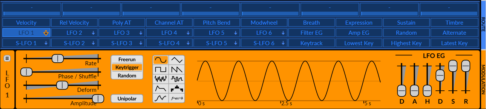

## Routing

Modulation routing in Surge is a bit different compared to most synthesizers,
but it's actually very intuitive and extremely powerful, thanks to the routing bar.

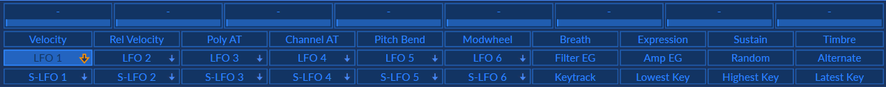

### How to apply modulation to parameters

Here's how it works:

1.  Select the modulation source you want to use.

    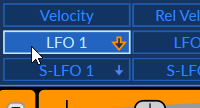

2.  Engage routing mode with a second click on the source. It will become bright green,
    and sliders that can be modulated will display a blue modulation depth slider on top of its normal slider.

        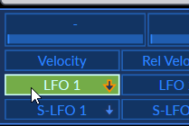

3.  Drag the desired modulation slider (blue slider) to the position you want the parameter to be at
    when fully modulated (at the top peak of a Sine LFO, or after the attack stage of an envelope for example).
    The modulation's full range will then be shown with the corresponding green bar on the slider.

        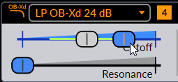

4.  Disengage routing mode by clicking again on the modulation source.

    

Alternatively, routing mode can also be engaged or disengaged by pressing **TAB**
on the keyboard, or by pressing the **middle**, **previous**, or **next** mouse buttons
anywhere over the interface.

You can also directly access the numerical modulation amount dialog (explained [here](/surge-xt/manual/archive/1.9/introduction-to-the-user-interface/#edit-value))
by holding down **Ctrl/Cmd** on the keyboard, then dragging the desired modulation source over the target parameter.

Note that modulation range is always **relative** to the base value represented by the gray slider,
meaning that moving its position will then shift the whole modulation range up or down.
This also means that if a modulation slider's value is smaller than the base value,
the modulation polarity will be inverted.

Also, when applying modulation to certain time-based parameters (such as Portamento, envelope attack, etc.) that are
set to 0.00 seconds, in some cases, the modulation won't trigger properly due to the way it works internally.
To fix this, simply increase the parameter in question by a very small amount, just so it doesn't have a value
of 0.

### Modulating LFO Parameters

When clicking on one of the LFO buttons in the routing bar, both the LFO source
selection and the LFO editor will be selected. However, the two actions can be separated, as you can choose which button is selected as the modulation routing source, and at the same time edit parameters from **a different
LFO** than the source.

To do that, select the source normally, and then click
on the mini-button on another LFO (the small orange arrow):

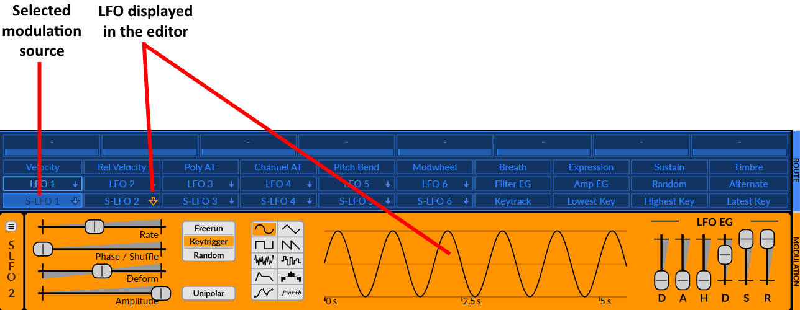

This effectively lets you **modulate the parameters of one LFO with any other mod source(s)**.
However, as an example, note that logistically, an S-LFO can modulate parameters of an LFO, but
an LFO **cannot** modulate parameters of an S-LFO
(see [Voice modulators vs. Scene modulators](#voice-modulators-vs-scene-modulators)).

Remember that you can also see which LFO is currently being displayed in the editor by looking at what's written
vertically to the left of the editor.

### Modulated sliders

Once a slider is routed to a modulation source, the shade of blue on its tray indicates
whether the parameter is modulated and by which source.

1. Parameter is not modulated (gray)

2. Parameter is modulated (gray-blue)

3. Parameter is modulated by the currently selected modulation source (bright-blue)

Moreover, if you hover your mouse pointer over any modulated slider, the source(s) it's being modulated
from will be highlighted in the routing bar. This makes it easier to see what modulation source(s) are
linked to a parameter.

### Modulation source buttons

Once routed to any parameter, the modulation source buttons change their appearance depending if they are selected,
and if they are routed in the current patch or not. (scene dependent)

1. Unused modulation source

2. Used modulation source

3. Unused selected modulation source

4. Used selected modulation source

### Clearing modulation

After right-clicking on a modulated slider, you will see an option to easily clear the modulation and un-link it from its source.

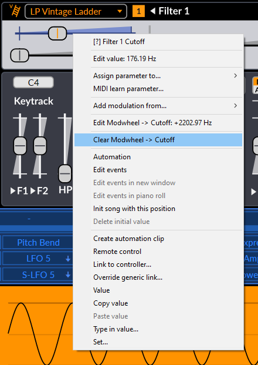

Alternatively, you can also reset its modulation slider (blue slider) to 0 by double-clicking on it
when routing mode is engaged, or entering 0 in the type-in editor (see [Edit Value](/surge-xt/manual/archive/1.9/introduction-to-the-user-interface/#edit-value)).

Furthermore, by right-clicking on any modulation source, there will be options to clear a particular linked parameter,
but also all of them at once.

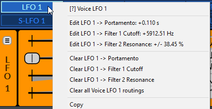

## Modulators

Surge has four main types of modulation sources :

-   LFOs
-   Internal modulators
-   Voice and note properties
-   Macros

All of these modulation sources are located in the routing bar (see [Routing](#routing)) :

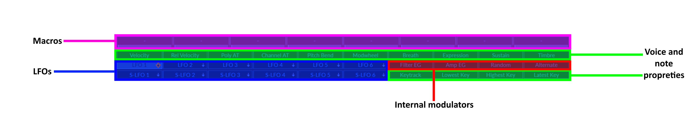

_The four types of modulation sources, separated in categories._

### Voice modulators vs. Scene modulators

Some modulation sources operate at the voice level, while others operate at the scene level.
Although they might seem similar, there is an important factor that distinguishes them.

One one hand, a voice modulator has separate modulation paths _for each voice_, meaning it can
control voice-level parameters (like filter cutoff) but cannot control scene level parameters (like FX levels or scene pitch).

On the other hand, a scene modulator has one identical modulation path _for the whole scene_, so it can control both scene level parameters **and** voice level parameters.

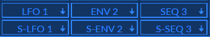

_On top, three voice LFOs. On the bottom, three Scene LFOs, "S-" meaning Scene._

To demonstrate this distinction, let's say an sine wave LFO is modulating the cutoff
of a filter. Now, if 3 notes are being hit with a small delay between each of them,
the phase of the LFO will be delayed between the notes accordingly.

You will indeed clearly hear the cutoff of the filter moving independently for each note, which gives the impression that there are three LFOs and three filters (which there actually is!).
The same principle applies for envelopes.

However, unlike the first demonstration, this time, if an S-LFO is modulating a certain parameter,
hitting more notes will not "add" an LFO for each voice, which gives the impression that there is a single LFO
modulating the cutoff frequency of the filter instead of many.

See [Modulation routing in-depth](/surge-xt/manual/archive/1.9/technical-reference/#modulation-routing-in-depth) in the Technical Reference section for more information.

### LFOs

Compared to some other synthesizers, Surge does not have dedicated **LFO**, **Envelope**, **Step sequencer** or
**MSEG** modulation sources. Instead, those are integrated within every LFO. This effectively enables the
flexibility of having up to 12 LFOs, envelopes, step sequencers or MSEGs, and everything in between simply by
changing their shape.

Surge's LFOs are very flexible and come with a built in DAHDSR-envelope which can
either work as a dedicated envelope generator or shape the amplitude of other modulation types over time.

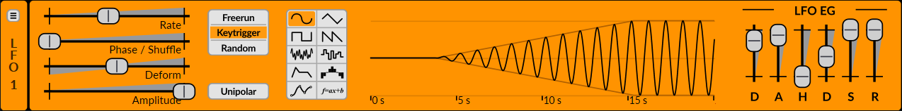

Surge has a total of 12 LFOs:

-   6 Voice LFO sources (labeled LFO 1-6 for instance)
-   6 Scene LFO sources (labeled S-LFO 1-6 for instance)

See [Voice modulators vs. Scene modulators](#voice-modulators-vs-scene-modulators) for an explanation about the difference LFOs and S-LFOs.

#### Shapes

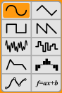

LFO shapes (from left to right, top to bottom):

|          |                                                                                                                                                                        |                                           |
| -------- | ---------------------------------------------------------------------------------------------------------------------------------------------------------------------- | ----------------------------------------- |
| Sine     | Sine wave LFO                                                                                                                                                          | Vertical bend                             |
| Triangle | Triangle wave LFO                                                                                                                                                      | Vertical bend                             |
| Square   | Pulse wave LFO                                                                                                                                                         | Pulse width                               |
| Sawtooth | Sawtooth wave LFO                                                                                                                                                      | Vertical bend                             |
| Noise    | Smooth noise LFO                                                                                                                                                       | Correlation                               |
| S&H      | Sample & Hold (stepped noise) LFO                                                                                                                                      | Correlation                               |
| Envelope | Envelope generator - sets the LFO to a constant output of 1, which can then be shaped by the LFO EG (see [LFO Envelope Generator](#lfo-envelope-generator))            | Envelope shape                            |
| Step Seq | 16 step step-sequencer (see [Step Sequencer](#step-sequencer)).                                                                                                        | Smoothness/Spikyness                      |
| MSEG     | Fully editable MSEG (Multi-Segment Envelope Generator) with a large number of curve types and various editing options (see [Envelope Generator](/surge-xt/manual/archive/1.9/scene-controls-section/#envelope-generators)) | Depends on segment type and configuration |

_On the left, the different shapes and their explanation. On the right, the way that the_ **_Deform_** _parameter affects the waveform._

Depending on the selected shape for a particular LFO, its name in the routing bar will change.
When using the first 6 waveforms, it will be called **LFO**. However, when using the envelope shape, **ENV**
will be displayed, **SEQ** will be displayed when the step-sequencer is used, and for the MSEG, **MSEG**
will be displayed. Scene LFOs have their equivalent labels as well:

#### Parameters

**Rate** – Controls the modulation rate. When the type is set to
Step Seq, one step equals the whole cycle. This slider can be tempo-synced
and deactivated from its context menu.
Deactivating the rate effectively freezes the LFO to a certain constant value depending on the
Phase/Shuffle parameter.
This can be useful for manually scrubbing in a waveform cycle of an LFO for instance, and can also be used in
the same way in the sequencer. This feature can also be used to make the modulation source act as a
**randomizer** in tandem with the "Random" trigger mode. A simpler [Random](#random-modulation-source)
modulation source can however also be used for that purpose.
Furthermore, modulation can even be applied to the Phase/Shuffle parameter with another modulation source
which opens up a lot of possibilities, such as effectively using the frozen LFO as a mod mapper.

Note: In the LFO editor, when right-clicking parameters that can be tempo-synced, there will also be an option to Tempo sync all the LFO parameters at once.

**Phase/Shuffle** - Controls the starting phase of the modulation waveform. As with any parameter,
it can be modulated. However, in this case, its modulated value will not change after the modulation is triggered
(for instance, it's not possible to shift an LFO's phase while a note is pressed).
Only starting phase is taken into account.

**Amplitude** – Controls the amplitude of the modulation. This is the parameter
you should use if you want to control the depth of an LFO with a
controller (like controlling vibrato depth with the modulation wheel, for instance). This control can also be
extended form its context menu, which allows you to reach a negative amplitude range (-100 to 100% instead of 0 to 100%).

**Deform** – Deform the modulation shape in various ways. The effect varies depending on the selected shape.
Different deform types are available for the **Sine**, **Triangle**, **Sawtooth** and **Envelope** shapes,
and can be accessed by right-clicking on the **Deform** slider.

**Trigger mode** – Chooses how the LFO is triggered when a new note is played:

-   **Freerun** – The LFO's starting phase is synchronized with the host's song position to make it continuously running in the background. The modulation will be trigged at its starting phase when playback position is either at the beginning position and the song starts playing, or when playback position goes back at the beginning of a loop
    for instance. Freerun behaves the same on voice LFOs or scene LFOs.
-   **Keytrigger** – The LFO's starting phase is triggered when a new note is pressed.
    If the synth is set to "Poly", each new voice gets its own LFO triggered with it when using a voice LFO.
    However, when using an scene LFO, the first voice sets the LFO's position, then the other ones will follow it.
-   **Random** – The LFO's starting phase is set to a random point in its cycle. If the synth is set to "Poly",
    each new voice gets its own LFO triggered with it when using an voice LFO.
    However, when using an scene LFO, the first voice sets the LFO's position, then the other ones will follow it.

**Unipolar** - If active, the modulation will be in the \[0 .. 1\]
range (unipolar). If not, it will be in the \[-1 .. 1\] range (bipolar).

The modulation range on a parameter is represented by a green bar when routing
mode is engaged (see [Routing](#routing)).

_Modulation on a control from a bipolar source_

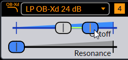

_Modulation on a control from a unipolar source_

#### LFO Envelope Generator

The Envelope Generators are of the 6-stage DAHDSR type that are
multiplied with the waveform generator, no matter what the selected LFO shape is.
This means that if the LFO shape is set to Envelope, the output will simply be 100%,
and can then be shaped by the LFO EG.

Also, note that when using the Envelope shape, the envelope will always trigger on key trigger,
no matter what the trigger mode is set to.

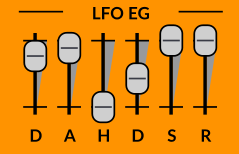

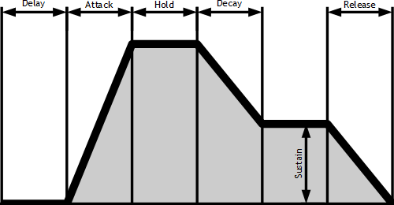

_6-stage DAHDSR envelope_

#### Step Sequencer

The **Step Seq** shape houses a step sequencing editor where the LFO display would be. It allows you to draw
the output waveform with up to 16 steps.

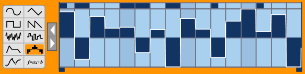

_Step Sequencer editor_

The two blue markers define loop-points in which the
sequence will repeat once it gets into the loop. The left mouse button is
used for drawing while the right one can be used to clear the values to
zero.

To quickly reset a step to 0, either double-click on a step, or hold down Ctrl/Cmd and click or drag with the mouse over
the desired step(s).

Right-clicking and dragging over steps allows you to draw a straight line over the desired steps,
thus creating a perfectly linear staircase pattern.

Holding down **Shift** while drawing will quantize the values to
the scale degrees (1/12th in case of standard tuning, or possibly other
for custom tuning) spanning the range of **one octave**.
Furthermore, holding down **Shift + Alt** makes two times more values available, hence
useful when modulating pitch by **two octaves** instead.

For more information on microtonal pitch modulation using the step sequencer, you can read
[this article](https://github.com/surge-synthesizer/surge-synthesizer.github.io/wiki/Microtonal-pitch-modulation-using-the-step-sequencer)
on Surge's wiki.

The step sequencers inside **voice LFOs** have an extra lane at the top of the
step editor allowing to re-trigger the two regular voice envelopes
(The Amplitude and Filter Envelope Generators) when the small
rectangle is filled at that particular step.

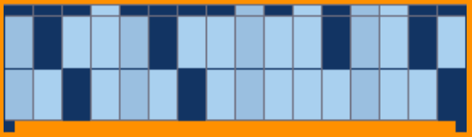

_Step Seq of LFO 1 containing the re-trigger pane_

However, shift-clicking or right-clicking those rectangles allows the specified step in the sequencer to **only
trigger one of the two envelopes**. When the step is half-filled on the left,
only the filter envelope will be triggered. When filled on the right, only the amplitude envelope will be triggered.

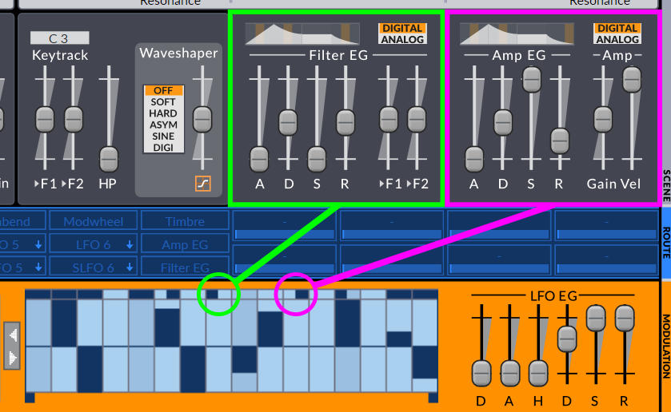

The **Deform** parameter gives the **Step Seq** waveform a lot of flexibility. A value of
0% will output the steps just as they look on the editor. Negative
values will give an increasingly spiky waveform while positive values
will make the output smoother.

|**Negative deform**| 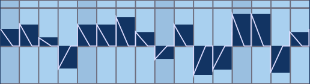|
|**Positive deform**| 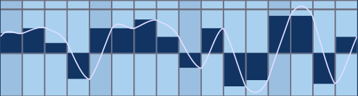|

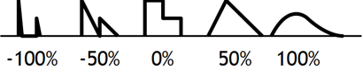

_Effect of the deform parameter on the step Seq waveform_

#### Multi-Segment Envelope Generator (MSEG)

Surge's Multi-Segment Envelope Generator (MSEG) is powerful and fully editable with a large number of curve types
and various editing options. It can be used to create more complicated LFO waveforms or envelopes
compared to the previously mentioned modulation shapes.
With the combination of various settings in the editing window and the usual parameters from the LFO editor,
you can practically create any modulation shape you could think of.

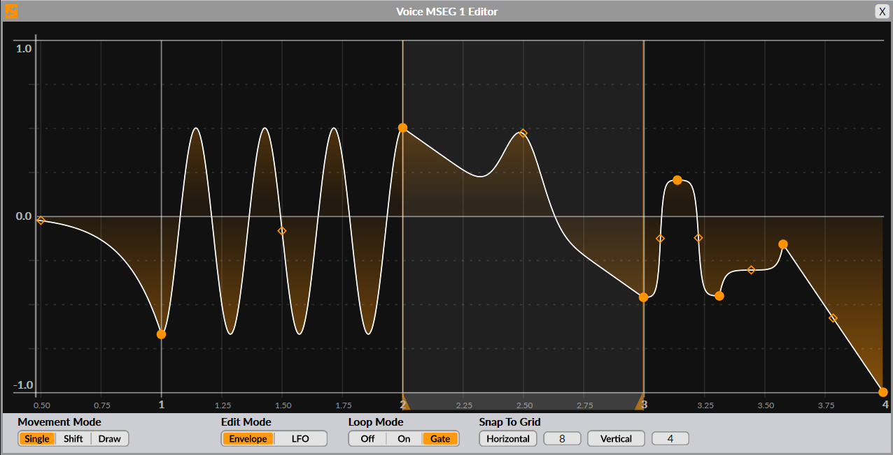

To open this MSEG editing window, you can either click on the little pencil button next to the wave display (1),
click on the wave display itself (2), or double-click on the MSEG icon in the modulation type selector (3):

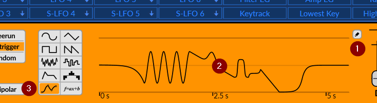

**Default MSEG state**

Once opened, you will see a shape working as an envelope if you're using a voice LFO, or a triangle wave
working as an LFO if you're using a scene LFO. In any case, you can either build upon these
shapes if they suit your needs, or you can reset them to a simple straight line by right-clicking anywhere
in the edit window, then choosing **Create -> Minimal MSEG**. More information on those menu entries can be
found below.

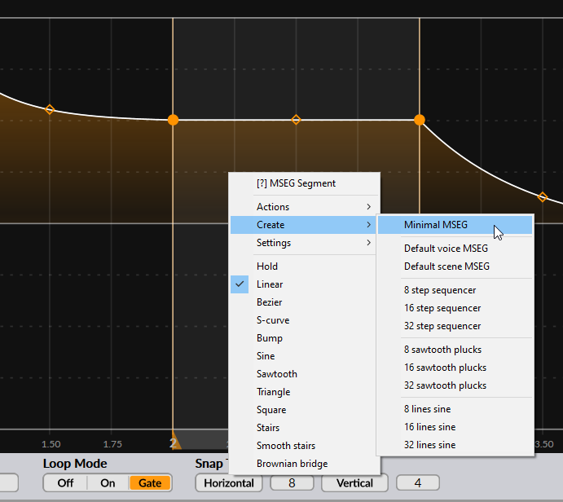

**Zooming and panning**

In the MSEG editor, you can pan the view left or right by either left-clicking or middle-clicking,
then drag on the background left or right.

You can also zoom in and out by either scrolling with the mouse wheel or left-clicking
then dragging your mouse up or down. Alternatively, you can again middle-click and drag if you prefer.

**Adding and removing nodes**

In Surge's MSEG, a segment is comprised of its starting node (point) and the segment itself. A "segment's end node"
is actually the next segment's starting node. To add a new node, simply double-click where you want it to
be added. To remove a node and its following segment, simply double-click on the node you want to remove.
Note that you can only remove nodes if there are more than two nodes remaining in the shape.

**Control points**

In addition, you will also often find a **control point** in the middle of a segment. This one can be dragged
vertically (and also sometimes horizontally) to alter the segment's curvature or other properties depending
on the line type. To reset a control point to its default position, simply double-click on it.

**MSEG editing and behavior options**

At the bottom of the editor are a couple of options to configure editing modes and general behavior of the MSEG:

-   **Movement Mode** - Sets the behavior when moving nodes.

    -   **Single** - When dragging a node horizontally, moves a single node without affecting the others.
    -   **Shift** - When dragging a node horizontally, shifts around the nodes following the node being moved, keeping the length of the segment belonging to that node constant.
    -   **Draw** - Locks horizontal dragging of nodes, allowing you to draw over existing nodes to set their value in a
        simple sweeping motion.

-   **Edit Mode** - Configures the MSEG editor to work in Envelope or LFO mode.

    -   **Envelope** - Displays draggable loop points and region (effectively representing the Sustain stage in an envelope).
    -   **LFO** - Hides the draggable loop points and region, links the value of the start and end nodes to complete the
        waveform cycle, always keep loop mode enabled (even if set to off).

-   **Loop Mode**

    -   **Off** - Don't loop when in Envelope mode, turn off draggable loop points.
    -   **On** - Loop forever in the loop region (between the loop points). Subsequent segments, if any,
        will never be reached.
    -   **Gate** - Loop until the note is released, then immediately transition to the segments following the loop region.

-   **Snap To Grid**
    -   **Horizontal** - Enables horizontal snapping to the grid. The number field to the right corresponds to the
        horizontal grid resolution. You can also temporarily enable horizontal snapping by holding down the Ctrl/Cmd key
        while dragging.
    -   **Vertical** - Enables vertical snapping to the grid. The number field to the right corresponds to the
        vertical grid resolution. You can also temporarily enable vertical snapping by holding down the Alt key
        while dragging.

**Segment options**

Each segment has options in a context menu which can be accessed with a right-click in the
area of that segment. Some of them are only applied to the right-clicked segment, while others are applied
to the whole shape:

-   **Actions**

    -   **Split** - Splits the segment into two by adding a new node in its center
    -   **Delete** - Remove the segment and its starting node
    -   **Double duration** - Doubles the total duration of the whole shape
    -   **Half duration** - Halfs the total duration of the whole shape
    -   **Flip vertically** - Flips the whole shape vertically
    -   **Flip horizontally** - Flips the whole shape horizontally
    -   **Quantize notes to snap division** - Quantizes the nodes in the whole shape to the nearest horizontal grid position. Available in Envelope edit mode only.
    -   **Quantize notes to whole units** - Quantizes the nodes in the whole shape horizontally to the nearest whole time units. Available in Envelope edit mode only.
    -   **Distribute nodes evenly** - Distributes the existing nodes from the whole shape evenly in the horizontal axis between the first and last node.

-   **Create**

    -   **Minimal MSEG** - Loads a straight line going from 1 to 0 in value, a great starting point to build upon.
    -   **Default voice MSEG** - Loads the default voice MSEG preset (envelope shape)
    -   **Default scene MSEG** - Loads the default scene MSEG preset (triangle wave LFO shape)
    -   **8, 16, 32 step sequencer** - Replaces the existing shape by an 8, 16 or 32-step sequencer shape
    -   **8, 16, 32 sawtooth plucks** - Replaces the existing shape by an 8, 16 or 32 sawtooth plucks shape
    -   **8, 16, 32 lines sine** - Replaces the existing shape by a sine wave made out of 8, 16 or 32 segments.

-   **Settings**

    -   **Link start and end nodes** - Links the value of the start and end nodes (useful for seamless
        looping for example).
    -   **Deform applied to segment** - Sets if the selected segment is affected by the
        Deform parameter found in the LFO editor or not (see [deform parameter](#parameters)).
    -   **Invert deform value** - Inverts the deform polarity applied to the selected segment.

-   **Segment types** - List of line types from which a segment can be. The control point, if present,
    will have a different effect depending on the type used.
    -   **Hold** - Holds the value of the previous node up to the segment's end node. No control point available.
    -   **Linear** - Single line. The control point controls the curvature of the segment.
    -   **Bezier** - Single line. The control point can freely bend the segment.
    -   **S-curve** - Curved line. The control point determines how abrupt the S-shape is and its direction.
    -   **Bump** - Single line. The control point can be moved up or down to create a "bump" in the segment.
    -   **Sine, sawtooth, triangle, square** - Sine, sawtooth, triangle or square waves.
        The control point determines how many wave cycles there are between the segment's beginning and end node.
    -   **Stairs, smooth stairs** - Stair or smooth stairs line types. The control point determines
        how many steps there are between the segment's beginning and end node.
    -   **Brownian bridge** - Random between the beginning and end node every time it's being triggered.
        Moving the control point down adjusts the number of steps while quantizing them up to 24 equidistant steps
        (useful for random scales, for instance). Moving the control point up also adjusts the number of steps, but
        this time without any quantization. The horizontal value of the control point adjusts correlation.

#### LFO presets

To the left of the **Rate** parameter, a small menu icon can be found. Clicking on it will reveal options to
save the selected LFO state, open previously saved states, and finally rescan presets to update the list.
Presets will be categorized by modulation shape.

#### Copy/Paste LFO settings

Finally, after setting up an LFO, its settings can be copied and pasted to another LFO
simply by right-clicking on any of them in the blue routing bar and using the option **Copy** and **Paste**.

For more information on LFO algorithms, see
[LFOs](#lfos) in the Technical Reference section.

### Internal modulators

#### Filter EG modulation source

The Filter Envelope Generator modulation source, which is labeled "Filter EG", is simply a modulation
source corresponding to the output of the Filter EG, which as its name suggests is already hardwired
to the filter modules. Other parameters can also be modulated by the Filter EG by various amounts,
simply by routing them to this source.

#### Amp EG modulation source

The Amp EG modulation source, which is labeled "Amp EG", is simply a modulation source corresponding to the
output of the Amp EG, which as its name suggests is already hardwired to the output amp module. Other
parameters can also be modulated by the Amp EG by various amounts,
simply by routing them to this source.

#### Random modulation source

This modulation source operates at voice level. It will generate a single random value inside the modulation range
for each voice every time a voice is played.

By default, this modulation source is bipolar. However, you can switch to a unipolar version of it by
right-clicking on it and selecting **Switch to Random Unipolar**. The two can also be used at the same time,
so they can be considered two independent modulation sources.

Note that multiple parameters routed to that modulation source will all receive the same value (in percentage).
To send different randomized values to different parameters, multiple LFOs can be
configured in a way to do this and with greater control. See the explanation of
[the **Rate** parameter](#parameters).

#### Alternate modulation source

This modulation operates at the voice level. It will generate alternating values between the two modulation range's
extremums.

By default, this modulation source is bipolar. However, you can switch to a unipolar version of it by
right-clicking on it and selecting **Switch to Alternate Unipolar**. The two can also be used at the same time,
so they can be considered two independent modulation sources.

### Voice and note properties

Like other synthesizers, Surge receives MIDI data to determine what note(s) to play.
However, it can also use **MIDI CC** data to modulate any routable parameter.

There are 14 of those voice and note properties in the routing bar:

|                                             |                                                         |                                                   |          |
| ------------------------------------------- | ------------------------------------------------------- | ------------------------------------------------- | -------- |
| **Velocity**                                | Per note velocity amount                                | Voice modulator                                   | Unipolar |
| **Release Velocity**                        | Per note release velocity amount                        | Voice modulator                                   | Unipolar |
| **Polyphonic Aftertouch (labeled Poly AT)** | Per note polyphonic aftertouch                          | Voice modulator                                   | Unipolar |
| **Channel Aftertouch (labeled Channel AT)** | Monophonic aftertouch if MPE is disabled                | Scene modulator,  Voice modulator in MPE mode | Unipolar |
| **Pitch Bend**                              | Pitch bend wheel value                                  | Scene modulator                                   | Bipolar  |
| **Modwheel**                                | Modulation wheel value                                  | Scene modulator                                   | Unipolar |
| **Breath**                                  | Breath controller signal                                | Scene modulator                                   | Unipolar |
| **Expression**                              | Often used in pedals and for crescendos or decrescendos | Scene modulator                                   | Unipolar |
| **Sustain**                                 | Sustain signal, often from a pedal                      | Scene modulator                                   | Unipolar |
| **Timbre**                                  | Primarily used for MPE controllers                      | Voice modulator                                   | Bipolar  |
| **Keytrack**                                | Per note keytrack value                                 | Voice modulator                                   | Bipolar  |
| **Lowest Key**                              | Keytrack value corresponding to the lowest note played  | Scene modulator                                   | Bipolar  |
| **Highest Key**                             | Keytrack value corresponding to the highest note played | Scene modulator                                   | Bipolar  |
| **Latest Key**                              | Keytrack value corresponding to the latest note played  | Scene modulator                                   | Bipolar  |

Note that only scene-level modulation sources can be routed to FX sends and parameters.
For instance, you can use **Latest Key** instead of **Keytrack** to modulate FX parameters, as Keytrack is
a voice-level modulation.
See [Voice modulators vs. Scene modulators](#voice-modulators-vs-scene-modulators) for more details.

### Macros

There are 8 macros, and by default, they are blank.

What separates these assignable controllers from the rest is that with a right-click, they can be
assigned to a MIDI controller or any MIDI CC signal, and their value can be edited on-screen
with the blue digital slider below their names.

By default, the macros are assigned to midi CC 41-48, which is often mapped by default to knobs or
slider banks for a lot of midi controllers.

See [Continuous Controller information (CC)](/surge-xt/manual/archive/1.9/technical-reference/#continuous-controller-information-cc) in the Technical Reference section for more information.

The right-click context menu also allows you to rename the controller.
There is also the typical routing and clearing options,
(see [Routing](#routing)) and you can choose if their modulation is bipolar (both positive and negative with 0
in the middle) or unipolar (just positive).

Macros can also be dragged and dropped over other macros to make them switch place. To do so, simply left-click + drag over the desired macro slot location.

Finally, note that macros are considered **global modulators**, meaning they are shared between and act on both
scenes A and B. This is useful in case you would want to quickly control certain parameters from both scenes
in a single place.
