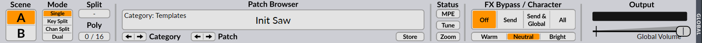
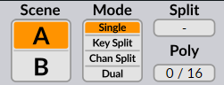
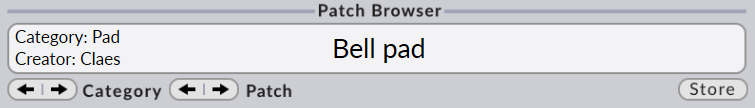
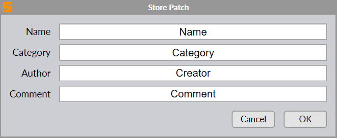
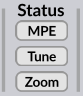
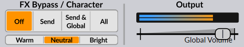

## Scene Select and Scene Mode

There are two setups of all controls within the Scene section of the user interface.
The **Scene Select** buttons **[A|B]** determine which one is selected for editing.
Right-clicking on these buttons brings up a context menu that allows you to copy/paste scene content.

Depending on the **Scene Mode**, these two buttons could also be used to choose which scene will be _played_.
Indeed, whether a scene will generate a voice when a key is pressed is determined by the **Scene Mode** setting:

-   **Single** – Notes will be played only by the selected scene.
-   **Key Split** – Notes below the **split key** will be played by scene A,
    notes above and including the **split key** will be played by scene
    B.
-   **Channel Split** Notes from MIDI channels below the **split MIDI channel** will be played by scene A,
    notes from MIDI channels above and including the **split MIDI channel** will be played by scene B.
-   **Dual** – Both scenes will play all the notes.

In both **Key Split** and **Dual** mode, if MPE is disabled, the system also supports MIDI channel routing where Channel 2 plays only
Scene A and channel 3 plays only Scene B. MIDI channel 1 and all other channels higher than 3 play the Split/Dual mode.

**Poly** shows the number of voices currently playing and allows you to
set an upper limit to the number of voices allowed to play at the same
time by dragging horizontally on the value. The voice-limiter will kill off excess voices gently to avoid
audible artifacts, thus it's not uncommon for the voice count to exceed
the limit.

## Patch Browser

### Navigating through presets

Finding sounds in Surge is easy: just press the arrow buttons
until you find something you like. If you left-click the patch-name
field (anywhere in the white area), a menu will list all available
patches arranged into categories. A right-click will bring up a menu with just the
patches of the current category.

These categories are also grouped into three sections depending on who created them:

-   Factory Patches - Patches created in-house by the Surge authors.

-   3rd party patches - Patches created by users and 3rd parties.
    Categorized by creators.

-   User Patches - Your own patches will be stored here. How you categorize them
    is entirely up to you.

Finally, at the bottom, there is an option to [download additional content](https://github.com/surge-synthesizer/surge-synthesizer.github.io/wiki/Additional-Content).

You can also directly load patches (.fxp) by dragging and dropping them anywhere over the Surge interface.

### The Store Dialog

Clicking the store button of the patch browser opens the store dialog.
This is where you name your new patch and choose which category it
should belong in. You can also create a new category manually here as
well. The patches you store will end up in the user section at the bottom
of the patch menu. The store dialog also provides text fields for the name of the patch creator
and comments.

Note: Comments are not currently shown in the main GUI.

## Status Area

This area is meant to be a quick access to some of Surge's features that are also present in the Menu.
(see [Menu Button](/surge-xt/manual/archive/1.9/menu-button/))

Right-clicking on one of these buttons will reveal more options which are also present in sub-menus under the Menu button as well.

For instance, the first time you press the **Tune** button if no custom tuning is loaded, it will open the same menu
as if you would have right-clicked on that button. Once a custom tuning is loaded however, left-clicking on it will
turn the loaded tuning on or off.

Alternatively, **.scl** and **.kbm** files can also be dragged and dropped anywhere on the interface to import
custom tuning.

See [Microtonal Tuning](/surge-xt/manual/archive/1.9/technical-reference/#microtonal-tuning) in the Technical Reference section for more information.

## FX-Bypass, Character and Global Volume

**FX Bypass** lets you quickly hear what a patch sounds like without the effect-units. (see [FX Section](/surge-xt/manual/archive/1.9/fx-section/))

-   **Off** – Bypass is disabled, all effects are active.
-   **Send** – The send effects are bypassed.
-   **Send + Global** - The send and global effects are bypassed.
-   **All** – All effects are bypassed.

**Character** controls the amount of high-frequency content present in
most of Surge's oscillator algorithms. Available choices are Warm, Neutral
and Bright.

**Global Volume** controls the last gain stage before the output. The
VU meter above it shows the output level and will become red if it goes
above 0 dBFS. You can choose to hard clip the global output either at
**+18 dBFS** (default) or **0 dBFS**.

The state of these two settings are **not** stored with patches. They
are however stored by the host application in your project files.
