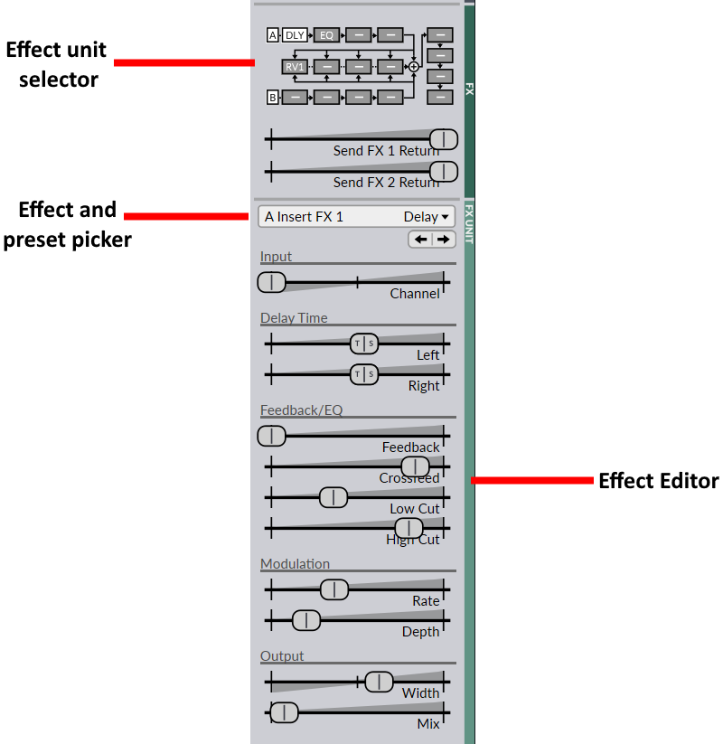
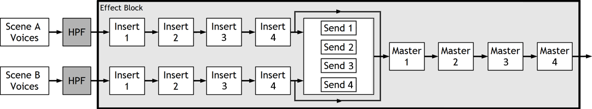

The FX Section controls the 16 effect units of the effect block
stored in every patch.

### Effect Unit Selector

The effect unit selector can be found towards the top of the FX section. It also represents the signal path
of the effects block. Here it is in more detail:

_The effect block_

A **left-click** on a particular unit in the effect unit selector brings that unit in the editor.
A **double-click** on a unit disables/enables it. This state is stored within patches,
unlike the global FX bypass setting.
A **right-click** on a unit displays the effect and preset picker specifically for that unit, allowing you to directly
add or swap an effect on that unit.
An **Alt/Option + Click** clears the desired FX unit.

Moreover, you can drag-and-drop units over other units to make them switch places. Holding down **Ctrl/Command** and
dragging allows you to duplicate (copy) units on other units instead, and holding **Shift** allows to simply replace
(overwrite) the target unit with the source one.

Finally, you can right-click on either the **A** or **B** icons in the diagram to bring up output hard clipping
options, which are the same as explained earlier in the [Scene Output](/surge-xt/manual/scene-controls/#scene-output)
and [Global Volume](/surge-xt/manual/header/#fx-bypass-character-global-volume) sections.

### Effect and Preset Picker

Effects can be added or removed from the **Effect and preset picker**
(just below the FX return sliders). You can also cycle through effects and presets using the
same arrow buttons as those found in the global [Patch Browser](/surge-xt/manual/header/#patch-browser).

You can also save your own effect presets which will be stored globally with
the synth. Finally, at the bottom of this menu, there are **Copy** and **Paste** options,
which allows you to copy an effect and its parameters and paste it on another unit.
You can also use drag-and-drop gestures to accomplish this
(see [Effect Unit Selector](#effect-unit-selector)).

### Effect Editor

This is where every effect parameter can be edited. Like with the oscillator editor, the parameter of each slider
will change depending on the loaded effect.

Here's a list of the available effects:

-   [EQ](/surge-xt/manual/technical-reference/#eq)
-   [Exciter](/surge-xt/manual/technical-reference/#exciter)
-   [Graphic EQ](/surge-xt/manual/technical-reference/#graphic-eq)
-   [Resonator](/surge-xt/manual/technical-reference/#resonator)
-   [Bonsai](/surge-xt/manual/technical-reference/#bonsai)
-   [CHOW](/surge-xt/manual/technical-reference/#chow)
-   [Distortion](/surge-xt/manual/technical-reference/#distortion)
-   [Neuron](/surge-xt/manual/technical-reference/#neuron)
-   [Tape](/surge-xt/manual/technical-reference/#tape)
-   [Waveshaper](12-technical-reference/#waveshaper)
-   [Combulator](/surge-xt/manual/technical-reference/#combulator)
-   [Frequency Shifter](/surge-xt/manual/technical-reference/#frequency-shifter)
-   [Nimbus](/surge-xt/manual/technical-reference/#nimbus)
-   [Ring Modulator](/surge-xt/manual/technical-reference/#ring-modulator)
-   [Treemonster](/surge-xt/manual/technical-reference/#treemonster)
-   [Vocoder](/surge-xt/manual/technical-reference/#vocoder)
-   [Chorus](/surge-xt/manual/technical-reference/#chorus)
-   [Ensemble](/surge-xt/manual/technical-reference/#ensemble)
-   [Flanger](/surge-xt/manual/technical-reference/#flanger)
-   [Phaser](/surge-xt/manual/technical-reference/#phaser)
-   [Rotary Speaker](/surge-xt/manual/technical-reference/#rotary-speaker)
-   [Delay](/surge-xt/manual/technical-reference/#delay)
-   [Reverb 1](/surge-xt/manual/technical-reference/#reverb-1)
-   [Reverb 2](/surge-xt/manual/technical-reference/#reverb-2)
-   [Spring Reverb](/surge-xt/manual/technical-reference/#spring-reverb)
-   [Airwindows](/surge-xt/manual/technical-reference/#airwindows)
-   [Conditioner](/surge-xt/manual/technical-reference/#conditioner)
-   [Audio Input](/surge-xt/manual/technical-reference/#audio-input)
-   [Mid-Side Tool](/surge-xt/manual/technical-reference/#mid-side-tool)

See [Effects](/surge-xt/manual/technical-reference/#effects) in the Technical Reference section for more information about each effect.

Note: remember that **FX parameters are scene controls**. This means that only scene-level modulation sources
can modulate them.
