Here's the instruction manual for the tuning editor which is built into Surge XT. It's an interface for loading, creating, modifying, and analyzing tunings.
These tunings will be played by the Surge XT instance you're working from. As of Surge XT 1.2, Surge itself can act as MTS-ESP source, which in effect means
you can use the Tuning Editor to control the tuning of all ([compatible](/surge-xt/microtuning-guide/methods/#mts-esp-client-list)) software instruments that are playing simultaneously.
You can also export the current tuning and keyboard mapping info as [.scl and .kbm files](/surge-xt/microtuning-guide/methods/#scala-files)

The integrated Surge XT Tuning Editor has a built-in collection of microtuning utilities for loading, modifying,
analysing and exporting Scala SCL-KBM tuning tables that enable working with a broad range of historical and
contemporary musical intonation systems.

It is also worth mentioning here that Surge XT supports the use and creation of non-monotonic intonation systems that may
not necessarily be sorted in a linear order.

**Keyboard Mapping** - On the far left of the Tuning editor UI, there is a keyboard diagram showing the current
tuning and how its frequencies are mapped directly to **MIDI Note Numbers** across the musical range.

Notice that when playing notes from a MIDI controller, that the keys will light up showing the notes that are being
played as well the fundamental pitches that Surge XT is sounding with each MIDI Note On.

## Visualizer mode while MTS-ESP client

In older versions, the Tuning Editor would simply disable when Surge XT was MTS-ESP client. From version 1.4 onwards,
the editor turns into a visualizer, that shows the relationships of the current tunings in cents. This requires that the MTS-ESP source
you're using has the updated API (version 1.03) that communicates the scale period and length to the clients.

## Edit Modes

Along the bottom left of the Tuning Editor are five buttons that switch between the different editing and analysis
functions:

### Scala

Click Scala button, where the values for the currently loaded Scala SCL and KBM file can be viewed and
or edited. In the left pane is the Scala SCL, with the KBM on the right. Notice here too that input from an attached
MIDI controller will highlight the scale degrees being played from the keyboard.

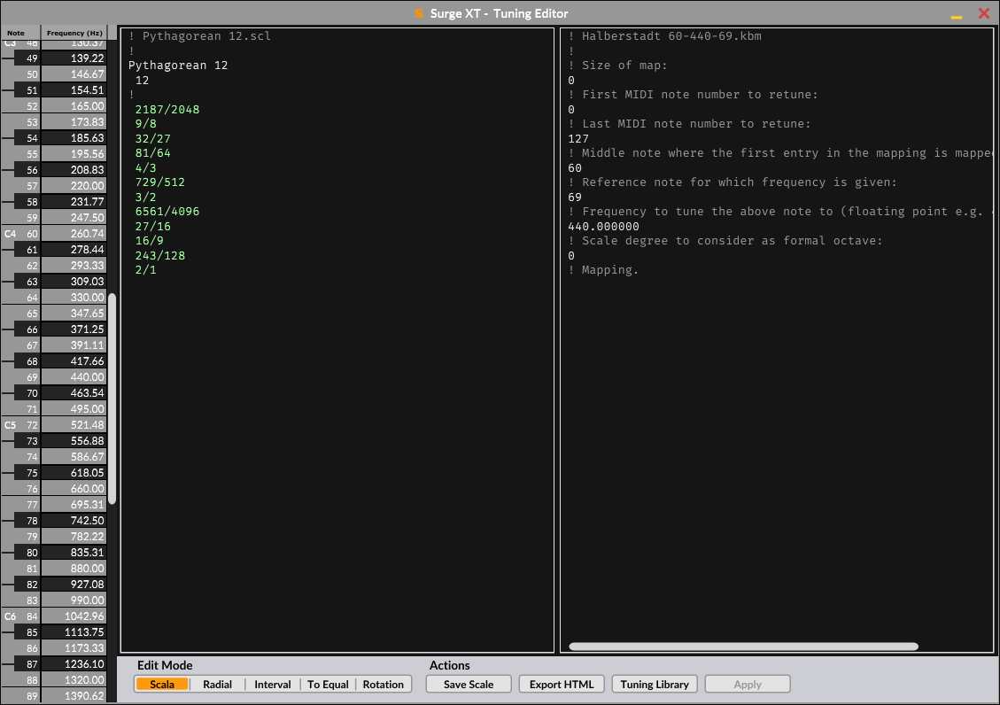

It’s possible to directly edit SCL and KBM values in either pane, then using the Save Scale feature, export the
results to any directory on the user’s computer. Editing SCL and KBM is a slightly advanced topic, so it is advised
to only make changes to tunings here, when one understands how these features work for creating custom tuning tables
that can be read by Surge XT, or any other virtual-instruments that use the Scala SCL-KBM format.

### Polar

Click the **Polar** button to access features for creating new scales, or otherwise modifying
existing ones, with its features for tuning by ear using either the Scale Tones on the left, or the Tone Wheel on
the right. As of Surge XT 1.3, the wheel has 2 modes, Radial and Angular, selected from the bottom left.
Radial, previously the only mode, shows the pitch of each scale degree as a distance from the center. Angular shows
the pitch of each degree as distance along the wheel's circumference.

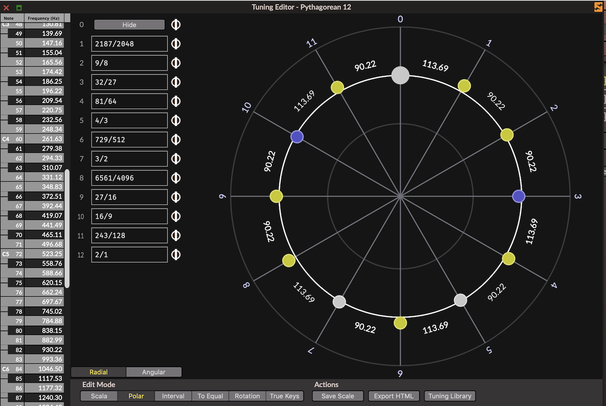
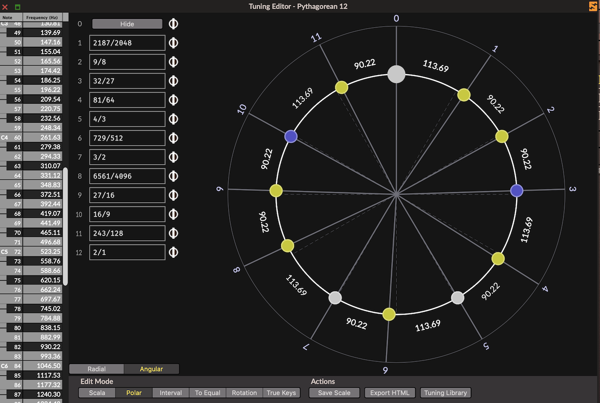

The **Scale Tones** features show the ratios or cents for each degree of the current tuning. The dials to the right of each scale degree can be used to retune each pitch of the scale by ear and the dial on the top right can be used to uniformly compress or stretch the current tuning.

Holding **Shift** on the typing keyboard while moving the tuning dials counterclockwise or clockwise allows fine
adjustments while retuning the scale by ear. Use the Hide button to hide the scale degrees when tuning by ear, then
click Show to see the results of the tuning exercise.

It is also possible to type new values for each of the scale degrees in either ratios or cents.

Any changes made to the Scale Tones dials are immediately reflected on the Radial Tone Wheel to the right, and it’s
also possible to click on the circular nodes of the Tone Wheel and retune each by ear as well.

Right-clicking a node of the Tone Wheel opens the rotation and inversion actions described in
[Rotating and Inverting the Scale](#rotating-and-inverting-the-scale).

### Interval

Provides a way to view the intervals of the current scale, given any two notes in the loaded scale and show the
interval in cents between them.

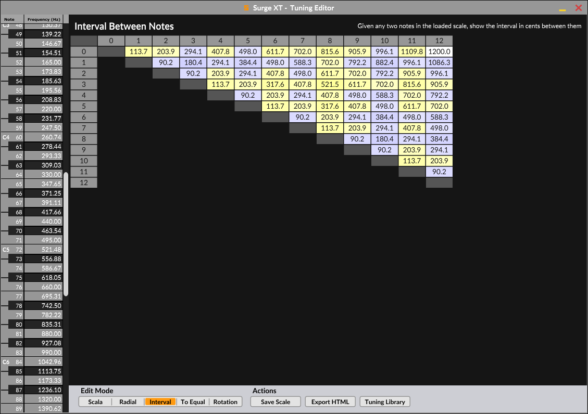

It’s also possible to hold keys on an attached MIDI controller, then click and drag on any of the columns to retune
each degree by ear in real-time.

Notice here too that input from a MIDI controller also highlights the scale degrees being played in the matrix.

### To Equal

Given any two notes in the loaded scale, show the distance to the equal division interval.

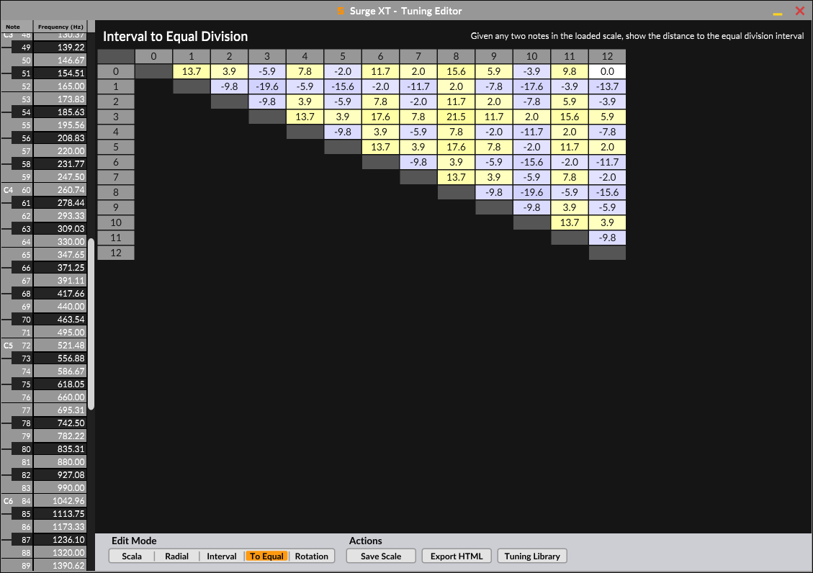

### Rotation

Shows the current tuning in an interval matrix for modal rotation analysis, where each row reveals the intervals
available from each starting point of the scale.

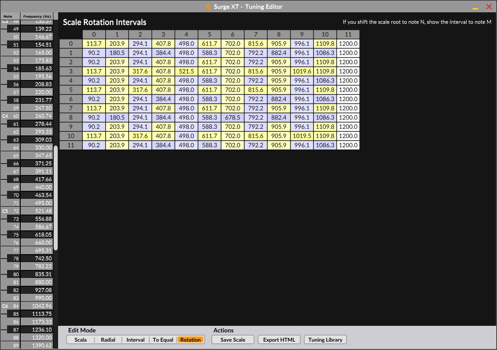

As of Surge XT 1.4, the page also carries a column for the octave interval, so the matrix lines up with the
[exported HTML](#export-html).

Right-clicking a row of the matrix offers the rotation actions described in
[Rotating and Inverting the Scale](#rotating-and-inverting-the-scale) below.

### Rotating and Inverting the Scale

Surge XT 1.4 adds a context menu for reshaping the loaded scale in place. It is available by right-clicking a node
in the [Polar](#polar) editor's tone wheel, or a row of the [Rotation](#rotation) interval matrix:

- **Invert Scale** - Mirrors the scale, turning its interval sequence back to front.

- **Rotate Scale to Degree _n_** - Rotates the scale so that the degree you clicked becomes the new root, which is
  the usual way to take a mode of a scale.

- **Rotate and Invert Scale to Degree _n_** - Both at once.

The two rotation entries only appear for degrees where rotating actually changes something. Rotating to the root, or to
the degree that closes the scale, would leave the scale exactly where it started, so those degrees offer **Invert Scale**
on its own.

This menu edits the scale, so it is unavailable while Surge XT is an MTS-ESP client, where the editor is a
[visualizer](#visualizer-mode-while-mts-esp-client) rather than an editor.

### True Keys

In Surge XT 1.3, we added a new visualisation mode to the Tuning Editor, called True Keys. It shows the distance in cents
between any MIDI notes currently held by the Surge XT instance.

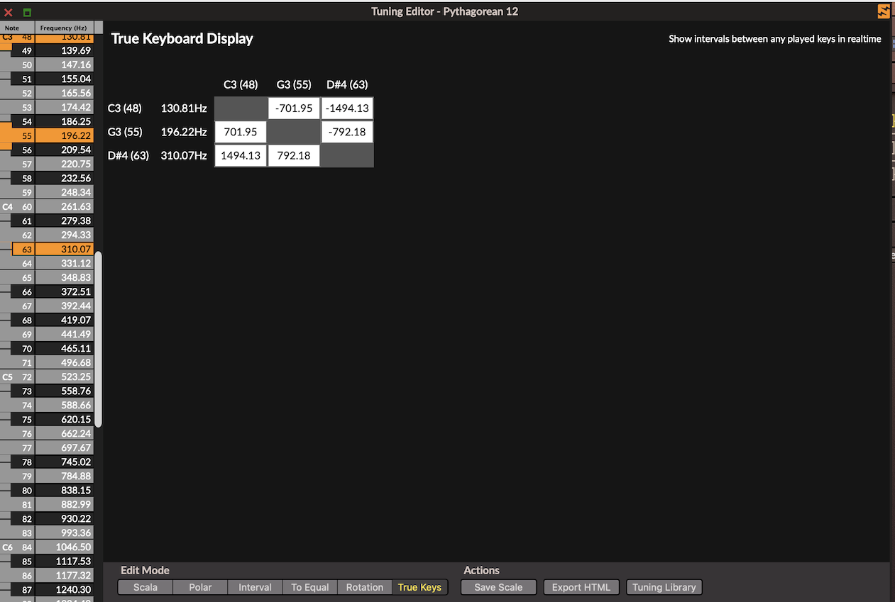

## Actions

The Surge SXT Tuning Editor has a set of Actions with the following features:

### Save Scale

Click this button to export the current scale in the Scala SCL format to any location on the user’s computer, where
they can later be loaded back into Surge XT, or other virtual-instruments that use the Scala format.

### Export HTML

Opens the current scale in an HTML page, where users can view complete information about the intonation, including
the Scala SCL scale degrees, the frequency mapping to MIDI Notes across the range, the KBM in use, as well as an
interval matrix that shows the current tuning under both modal and interval rotation. More information can be found
below.

### Tuning Library

Clicking the Tuning Library button will open the directory containing the Surge XT factory SCL and KBM content,
making it easy to drag-and-drop SCL and KBM files onto the UI.

## Export HTML

Clicking the Export HTML button from within the Surge XT Tuning Editor opens the current tuning in an HTML page
enabling viewing information about the loaded Scala SCL and KBM files, and how the pitches are mapped to MIDI Notes
on the keyboard controller.

The exported HTML page then shows the tuning description contained in the SCL file, the degrees of the scale, and
the mapping of pitches to MIDI Notes. Below we can see that the Bohlen-Pierce tuning is mapped with its 1/1 starting
note on C.60 at 261.626 Hz.

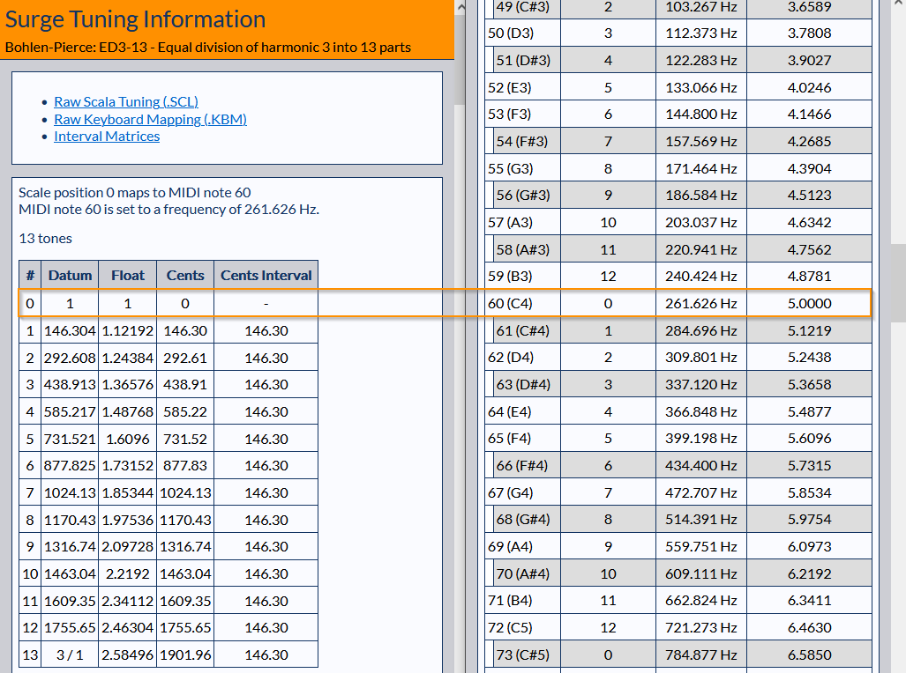

To change the 1/1 mapping to another MIDI Note, drag-and-drop a different KBM file onto the Surge XT interface, then
click the Export HTML button again to see how it changed the mapping.

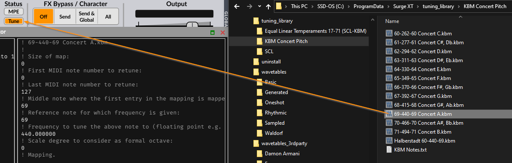

Below we can see that the 1/1 for Bohlen-Pierce is now mapped to MIDI Note A.69 at 440 Hz:

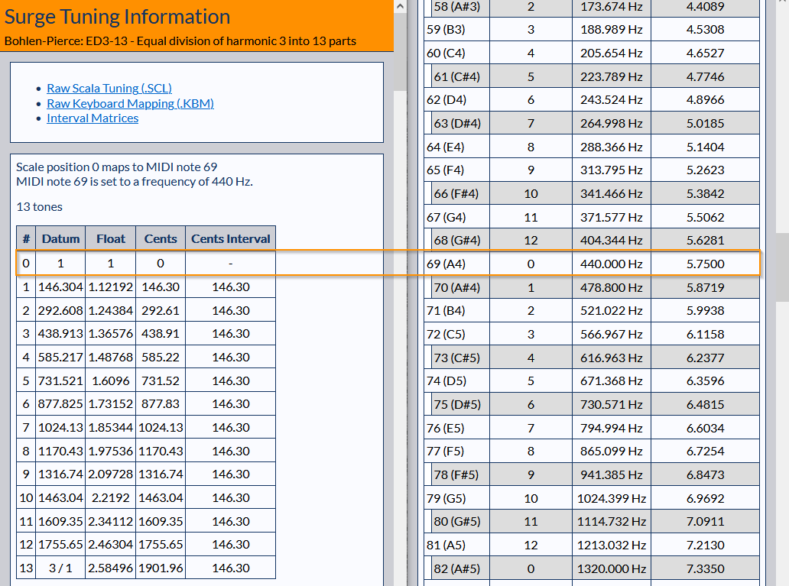

Click the Raw Scala Tuning (SCL) or Raw Keyboard Mapping (KBM) links to view the mapping data for the currently loaded SCL and KBM files.

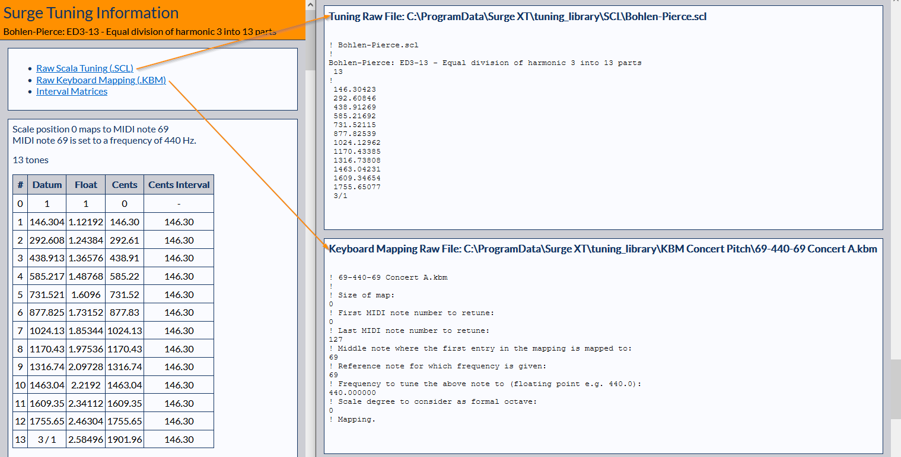

Click the Interval Matrices link to view a modal rotation of the current tuning by scale degrees and interval steps.

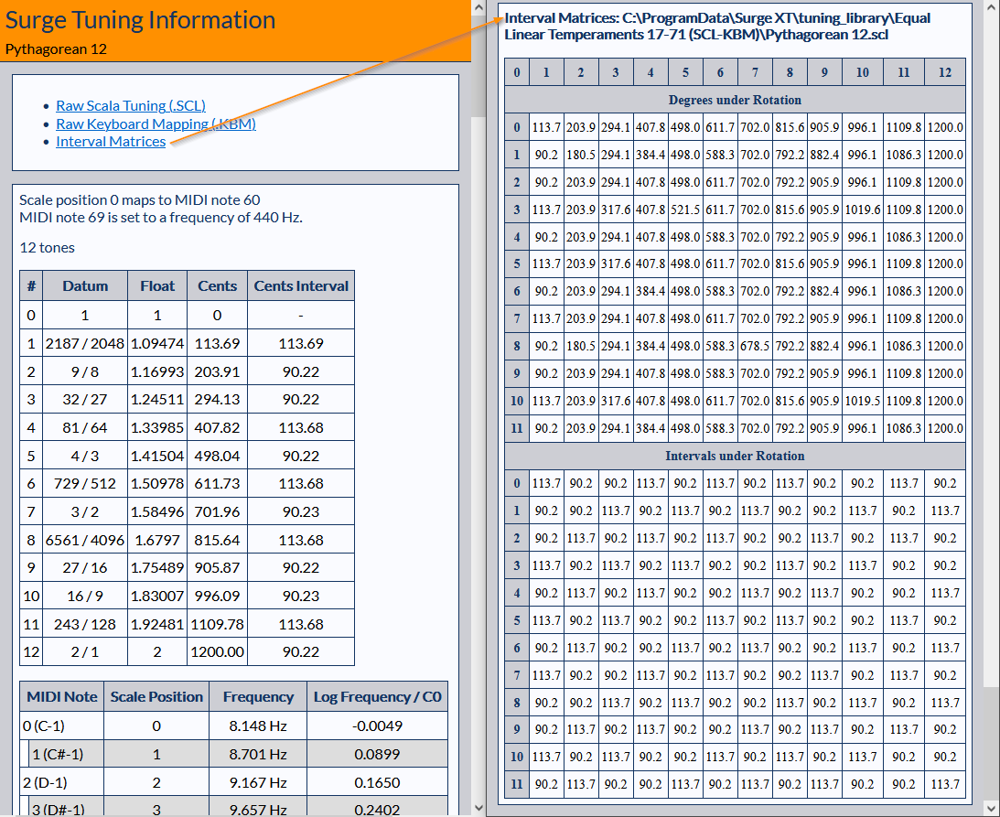
