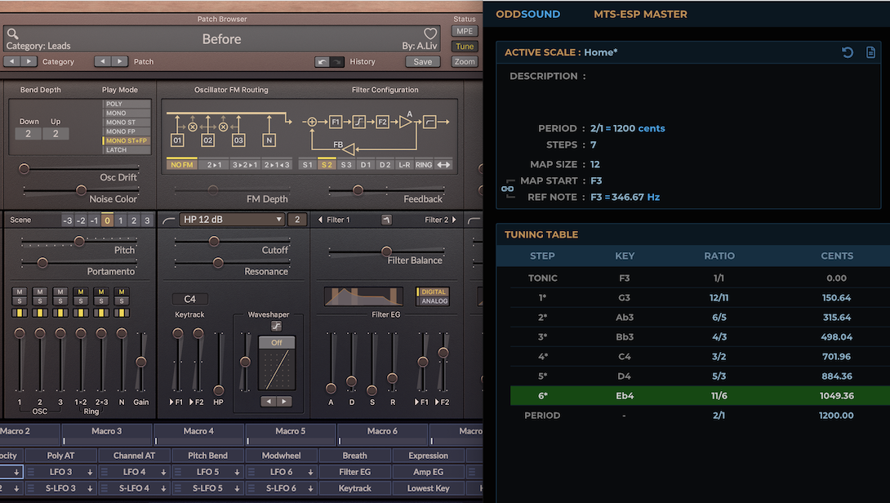

**Welcome to the Surge Synth Team tuning guide!**

Microtuning, also known as intonation or simply tuning, is a somewhat underdeveloped aspect of modern music making. Surge XT has become
renowned for its extensive capabilties in this regard, the goal of which is simply to let the musician decide how the notes heard in their
music should be tuned. Since the implementation found in SST products is going to be consistent for times to come, we gathered all
relevant information in this guide. Hopefully you will find this useful in your exploration.
