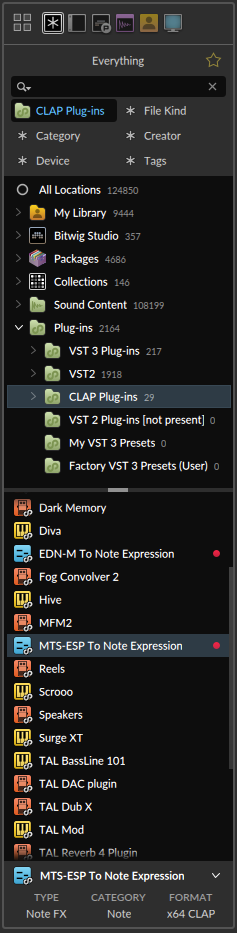
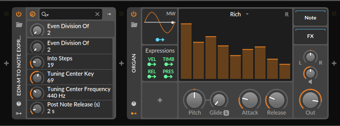
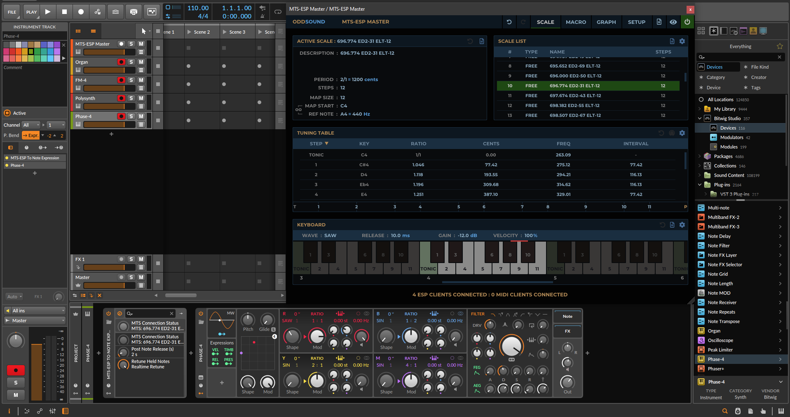

The Surge Synth Team tuning-note-claps is a CLAP format plugin that contains two separate devices — EDN-M To Note Expression and MTS-ESP To Note Expression — which can be used to microtune various devices included with Bitwig Studio, by means of CLAP note expressions.

As of July 17th 2023, the Bitwig devices that can be microtuned with the tuning-note-claps are: FM-4, Organ, Phase-4, Poly Grid, Polymer, Polysynth,
Sampler, Resonator Bank, Vocoder Keytrack+, and Nice Drums V0, V8 and V9.

**EDN-M To Note Expression** can be used to tune the Bitwig instruments to a large range of **equal-temperaments**.

**MTS-ESP To Note Expression** Connects with **MTS-ESP**, and retunes incoming MIDI notes accordingly. This effectively makes the entire
suite of Bitwig Studio devices compatible with MTS-ESP. For more info on what this means, check the [MTS-ESP](/surge-xt/microtuning-guide/methods/#mts-esp) section.

## Installation

To install the tuning-note-claps devices on Linux or Windows, download the plugins from [here](https://github.com/surge-synthesizer/tuning-note-claps/releases) and extract the
tuning-note-claps.clap plugin into the CLAP plugin directory.

// Linux
// - ~/.clap
// - /usr/lib/clap

// Windows
// - %COMMONPROGRAMFILES%\CLAP
// - %LOCALAPPDATA%\Programs\Common\CLAP

On MacOS, use the included installer to install the plugin in the CLAP directory.

Once installed, the two tuning note devices will appear in the Bitwig Studio browser in the CLAP plugins category:

## Using the EDN-M device

1. Insert an instance of the EDN-M To Note Expression device into an empty Instrument Track, followed by one of the instrument devices, then arm the track for recording and reception of MIDI from a connected external MIDI controller.

2. Specify the repetition-interval for the equal-temperament using the topmost Even Division Of control, to set the desired harmonic as an integer value.

3. Configure the equal division of the repetition-interval using the Into Steps control.

4. Specify the MIDI Note on which the 1/1 starting note of the equal-temperament will be mapped using the Tuning Center Key control. For example, setting this to 60, will map the 1/1 to MIDI Note C.60, while setting it to 69, will map the 1/1 to A.69.

5. Specify the frequency of the 1/1 starting note for the equal-temperament using the Tuning Center Frequency control. For example, setting this to 261.626 in combination with the Tuning Center Key set to 60, will map the 1/1 on MIDI Note C.60 at a frequency of 261.626 Hz, while setting it to 440, with the Tuning Center Key set to 69, will map the 1/1 on A.69 at 440 Hz.

6. Use the Post Note Release (s) control to add a release time value, specified in seconds, to each played note. (Only relevant if the tuning changes during the release stage)

Of course, all parameters of the EDN-M To Note Expression device can be modulated with the Bitwig modulation devices.

## Using the MTS-ESP device

In order to use the MTS-ESP To Note Expression CLAP device to microtune the integrated Bitwig instruments, an MTS-ESP master (source) must be present in the project. See [MTS-ESP sources](/surge-xt/microtuning-guide/methods/#mts-esp) for more information on this.

For this basic overview, we'll assume the source is ODDsound MTS-ESP Master. To illustrate its ability to dynamically change the intonation for ensembles of instrument devices in tandem, lets configure Bitwig for this purpose.

1. First, insert an instance of MTS-ESP Master into an empty track, which will be used to control the intonation of all instrument devices loaded into the project. Then open some individual tunings, or Scale List presets, that will be used in the sequencing project.

2. On the next four successive tracks, load instances of Organ, FM4, Polysynth and Phase-4, then set each of their MIDI reception channels to receive MIDI on channels 1 through 4.

3. Before each of these Bitwig instrument devices, place an instance of the MTS-ESP To Note Expression CLAP, which will then communicate the tunings loaded in MTS-ESP Master to the instruments that follow. The CLAP plugin will even display the name of the currently loaded tuning.

With this basic multi-track MIDI configuration, when the tunings are changed in MTS-ESP Master, the four instruments loaded on the adjacent tracks will follow those changes and retune the virtual-ensemble accordingly. Now it's possible to individually perform and record MIDI on each of the instrument tracks using one common musical intonation system.

