If you've tried to use Surge XT's Step Sequencer making pitch sequences and couldn't get it to work right, you've come to the right place!

## Before we begin, a few things to consider.

First of all, this currently doesn't work with [MTS-ESP](/surge-xt/microtuning-guide/methods/#mts-esp) tuning. There used to be nothing we could do about that due to limitations of the
MTS-ESP API. That's been adressed, though making this work in Surge still requires some code changes we haven't yet made. So for now this will work with Scala file tuning only.

Secondly: You have to select the option **"Apply Tuning After Modulation"** in Surge XT, without which none of this will work correctly.
So make sure you've done that before we start.

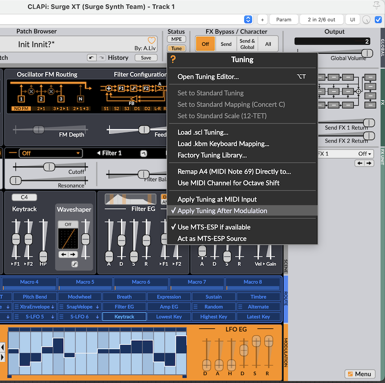

## Modulating Scene Pitch vs. Oscillator Pitch

Another initial consideration in configuring Step Sequencers for microtonal sequencing is that there are actually two possible Pitch Modulation targets to which Step Sequencer modulation-sources may be assigned:

### Scene Pitch

Modulating Scene Pitch with one, or multiple, Step Sequencers is useful where one wants all three oscillators in a Scene to track the pitch in unison. With Scene Pitch modulation using more than one Step Sequencer, all of the modulation sources are summed to a single voice. Polyphonic input from a MIDI controller is still possible, but each voice contains the sum of all running Step Sequencers assigned to Scene Pitch.

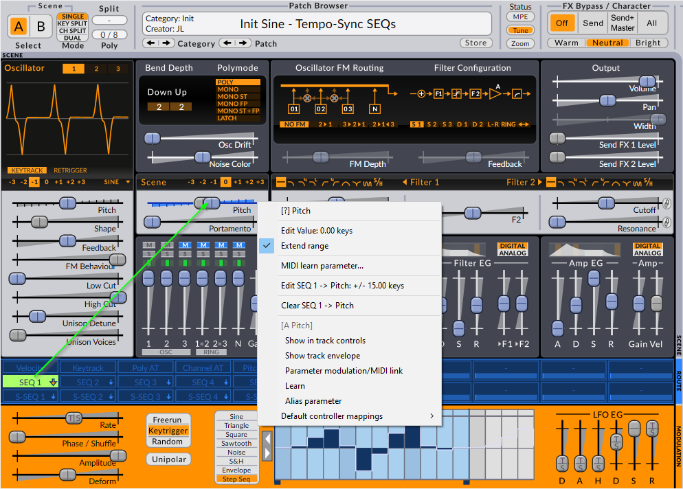

### Oscillator Pitch

With Oscillator Pitch modulation using the Step Sequencers, it is possible to route separate sequencers to each of the three available oscillators in a Scene. In this scenario, it becomes possible for the sequencers to trigger chords as the notes from each Step Sequencer play together.

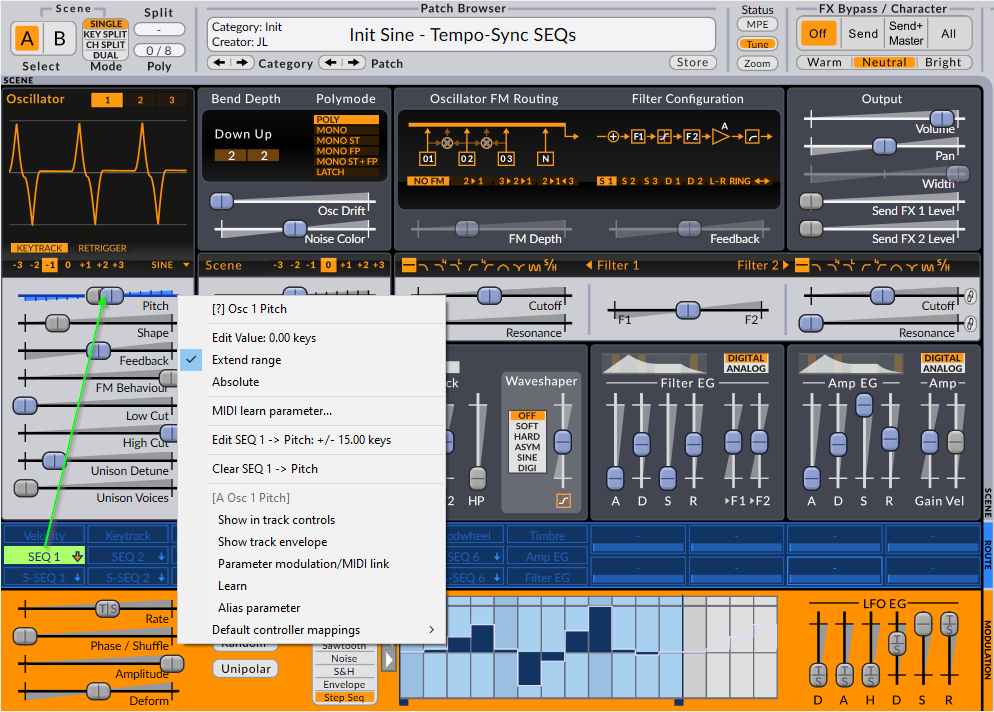

## Making Modulation Assignments

Since the processes for routing Step Sequencer modulation-sources to either **Scene Pitch** or **Oscillator Pitch** are functionally identical, in this brief overview, we’ll focus on assigning Step Sequencers to Oscillator Pitch for microtonal pitch sequencing:

1. Load a Scala **SCL** microtuning table file to use with the Step Sequencer, as outlined in the [Microtuning section of the user manual](https://surge-synthesizer.github.io/manual-xt/#microtuning). For this example, we’ll use 15-tone-equal-temperament, which is available in the factory data tuning-library as ED2-15 (Equal division of harmonic 2 into 15 parts).

2. Right-Click on the **Oscillator Pitch** slider, and check **Extend Range** in the context menu. Doing this enables pitch sequencing with SCL microtonal tuning tables of arbitrary size.

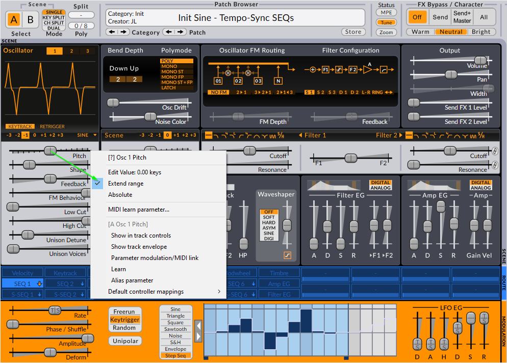

3. Assign a SEQ modulation-source to the Oscillator Pitch. For more info on assigning modulation sources to targets, read [this section in the manual](https://surge-synthesizer.github.io/manual-xt/#modulationrouting). Once you've done so, right-click the **Oscillator Pitch** slider and type-in the number of notes in your scale. In our example case, that's 15). If you're not sure what number this should be, you can open the [tuning-editor](/surge-xt/microtuning-guide/editor/) and check the scala tab, the first number on the top left is the number you need. Here, it is also possible to type-in a range twice the loaded SCL scale size (in our example case, 30) for creating microtonal pitch-sequences over a range of two times the **repetition interval** (the interval at which any scale repeats across the range, usually but not necessarily an octave), more on this below.

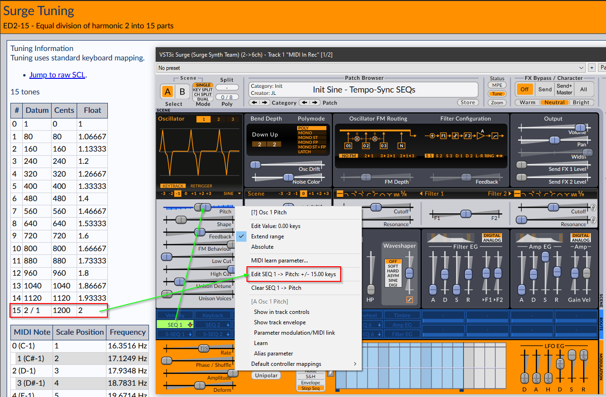

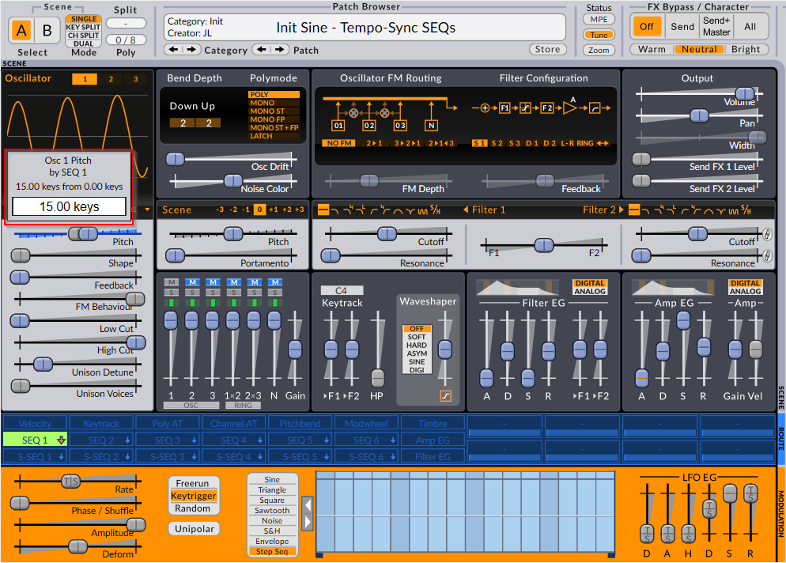

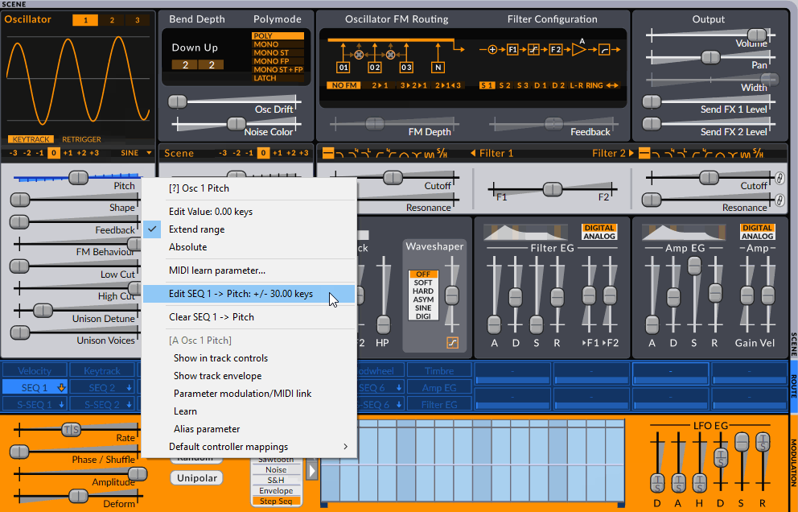

4. You've now correctly configured the modulation depth for the step sequencer to play the oscillator pitch in tune. We are now ready to create our microtonal Step Sequencer patterns. Here's the trick, the mouse modifiers which quantize the steps to scale degrees (which usually would make 12-equal steps only) will now be **‘SCL-aware’**. In the **Step Sequencer Editor**, place the mouse cursor over one of the 16 steps, hold **Shift**, then drag up or down to create a pitch-quantized step over the range of **one repetition interval**. If you previously set your modulation depth to **two repetition intervals** (30 instead of 15 in our example), you should instead use **Alt+Shift+Drag** to quantize to that doubled range. Here, one will notice that a popup appears, showing the pitch-quantized adjustments as they snap to degrees of the loaded SCL file when one drags the mouse up and down.

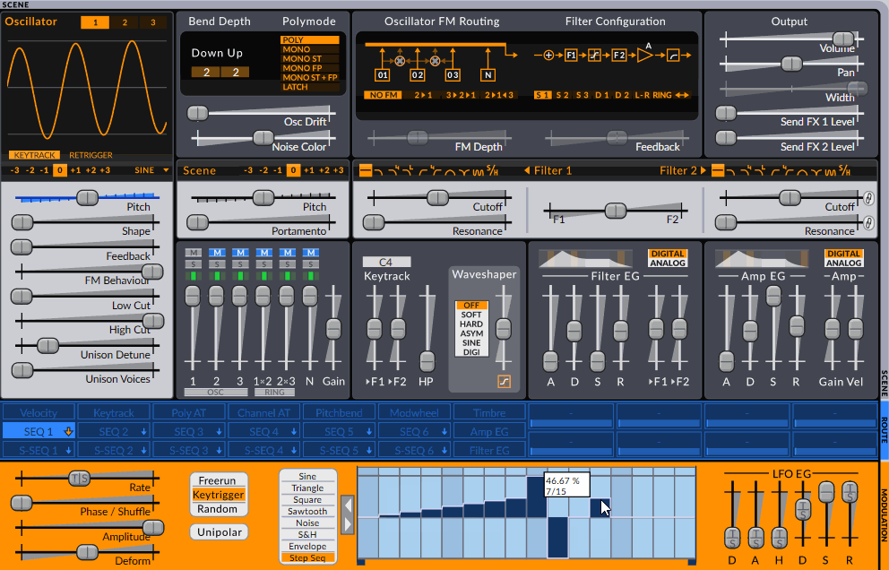

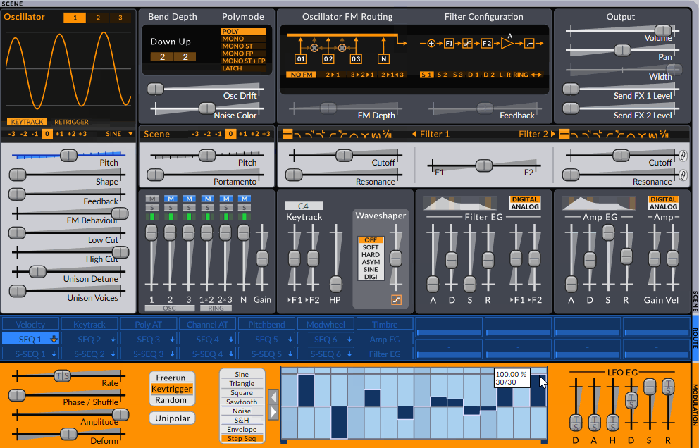

5. It is also possible to draw straight-lines across multiple steps in the **Step Sequencer Editor** and quantize their pitches to degrees of the loaded SCL microtuning table file, using the **Right-Mouse-Button** in combination with the **Shift+Drag** and **Alt+Shift+Drag** mouse-modifiers.

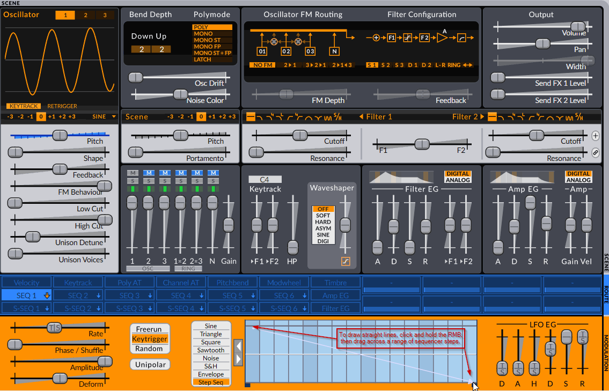

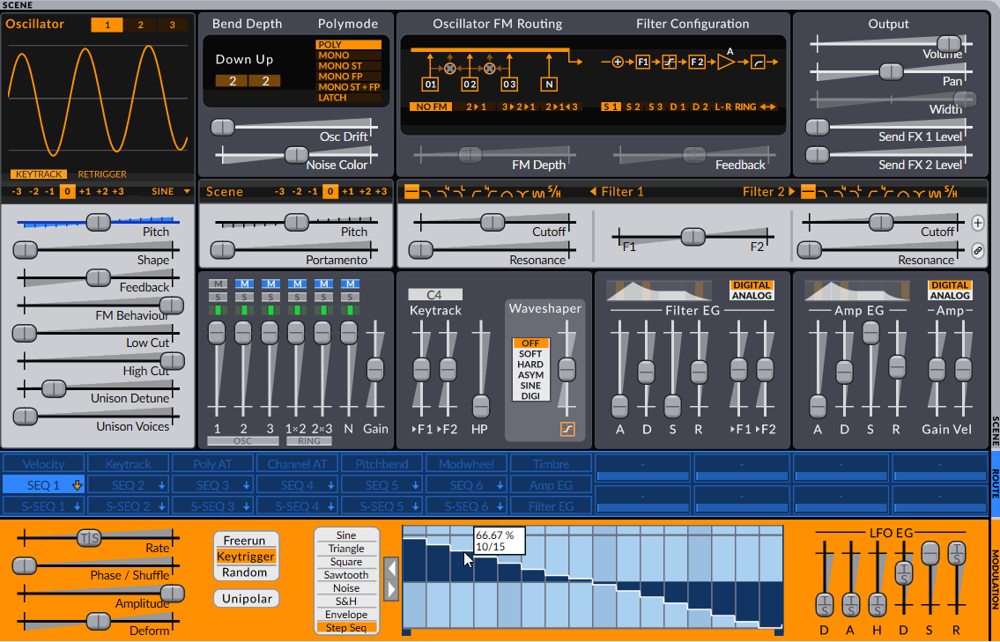

## Mouse Modifiers Reference

Use the below keyboard modifiers to create sequencer steps that are quantized to the pitch of the loaded SCL microtuning table file:

- **Shift+Drag** for quantizing vertical sequencer-editor steps to scale degrees
  spanning a range of one repetition interval (2/1, 3/1, 4/1, etc.). _ **Alt+Shift+Drag**
  for quantizing vertical sequencer-editor steps to scale degrees spanning a range
  of twice the repetition interval. Doing this effectively doubles the number of vertical
  steps in the sequencer-editor. _ **Shift+Right-Mouse-Button+Drag** for drawing straight-lines
  across multiple steps in the sequencer-editor that quantize to scale degrees spanning
  a range of one repetition interval. _ **Alt+Shift+Right-Mouse-Button+Drag** for drawing
  straight-lines across multiple steps in the sequencer-editor that quantize to scale
  degrees spanning a range of twice the repetition interval. _ **Double-Click** to
  clear individual sequencer steps, or Ctrl+Drag across a range of steps to clear them.
- **Note**: Without any keyboard-modifiers, the pitch is not quantized to the loaded
  SCL file and essentially functions as a stepped modulation-source similar to an LFO.

Enjoy your microtonal step sequencing!
